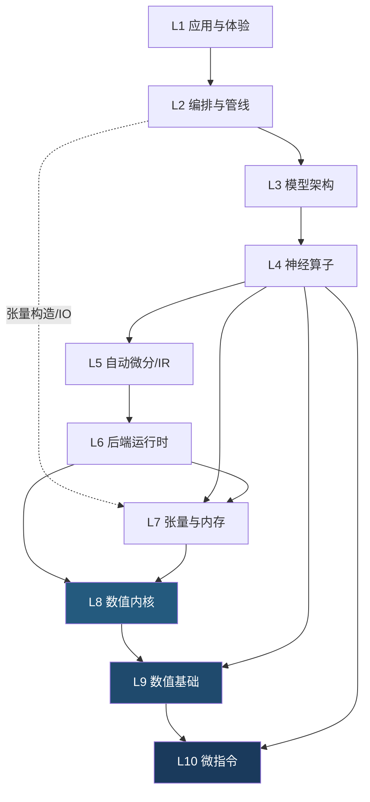
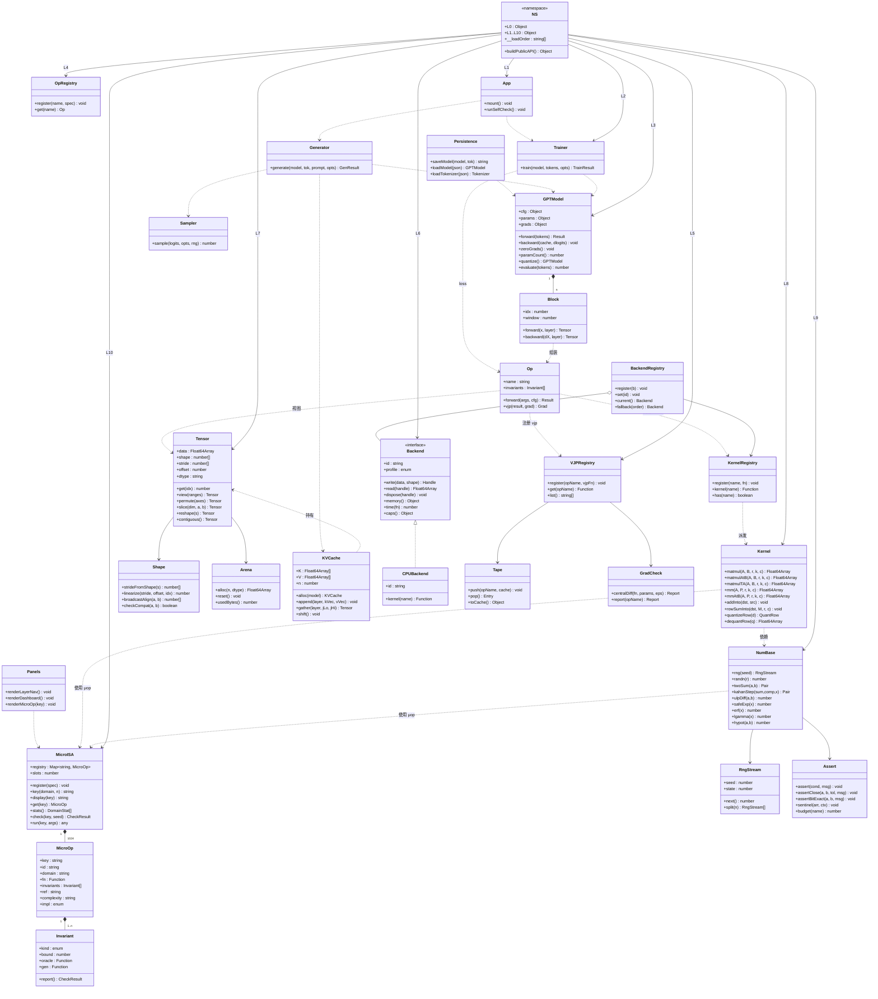
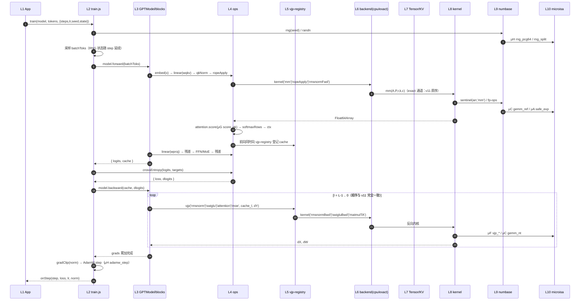
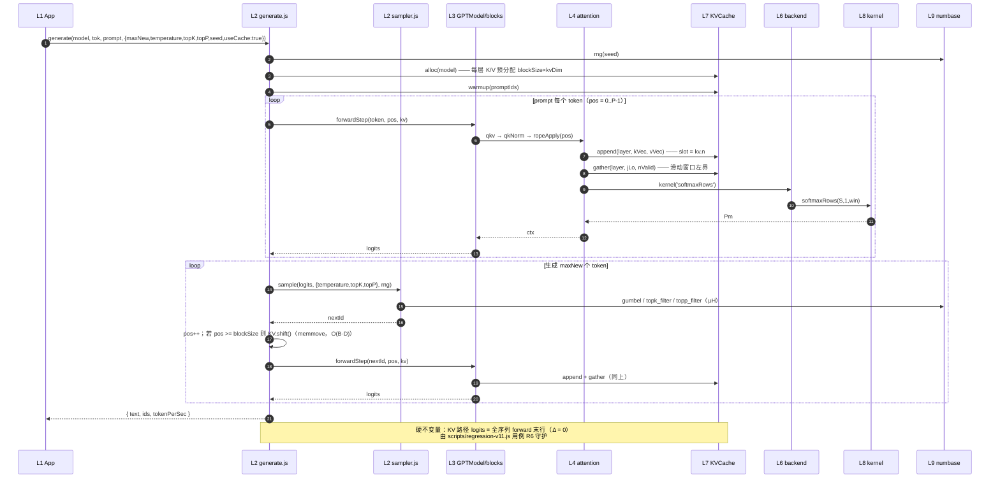
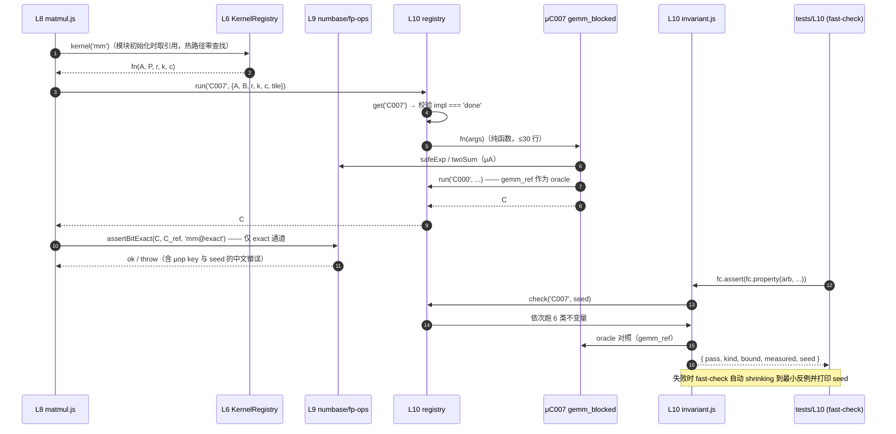
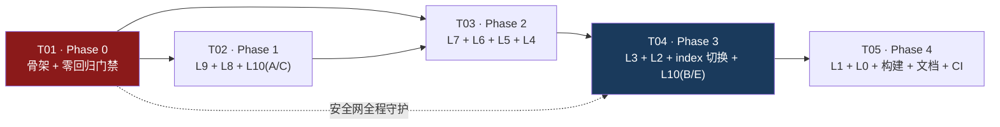

# Flagship AI v12.0 · 十层分解架构设计

> 作者：高见远（架构师）· 依据 `docs/PRD.md`（许清楚）与实测基线 · License: MIT
> 本文档是 **v12 重构的施工图**。v11 的 `docs/ARCHITECTURE.md` **保留不动**，作为对照。
> 一句话：**把 v11 的 1571 行单文件按 L1→L10 拆开，全程用冻结的 v11 做逐位 oracle，每拆一层验一层。**

---

## 0. 三条贯穿全文的硬约束（先讲结论）

| 编号 | 硬约束 | 本设计的应对机制 |
|---|---|---|
| **C1** | `file://` 双击即跑、零构建、零运行时依赖 | **不用 ESM**。全部层文件为「IIFE 注入 `globalThis.FlagshipAI`」的经典脚本；Node 侧 `require` 同一批文件，浏览器侧由 `build-demo.js` **按层序拼接**进一个 `<script>` |
| **C2** | 逐位零回归 **maxΔ = 0** | **双内核通道（exact / fast）** + **冻结 legacy oracle** + **同进程内 Δ=0 比对**。任何改变浮点运算顺序的优化（分块 GEMM / Kahan / online-softmax）一律关在 `fast` 通道 |
| **C3** | 分批可验证，禁止瀑布 | 分 5 个 Phase（T01–T05），每 Phase 结束 `npm run test:all` + `node scripts/regression-v11.js` 全绿；**Phase 0 先把安全网建好再动刀** |

---

## 1. 实现方案与框架选型

### 1.1 模块系统决策（本设计最关键的技术决策）

#### 现状

```js
// src/flagship-engine.js（v11，UMD/IIFE 闭包）
(function (root, factory) {
  if (typeof module !== 'undefined' && module.exports) module.exports = factory();
  else root.FlagshipAI = factory();
})(typeof self !== 'undefined' ? self : globalThis, function () { /* 1571 行 */ });
```

`demo.html` 由 `scripts/build-demo.js` 把 4 个文件**纯文本内联**到 `demo.template.html` 的 4 个 marker 里产出，`window.FlagshipAI` / `window.FlagshipVerify` 供 `app.js` 使用。

#### 候选方案对比

| 方案 | Node | 浏览器 `file://` | 结论 |
|---|---|---|---|
| **A. Node 原生 ESM** + `<script type="module">` | ✅ | ❌ **致命**：ESM 走 CORS 抓取，`file://` 的 origin 是 `null`，Chrome/Edge/Firefox/Safari **全部拦截**，浏览器控制台报 `CORS policy: Cross origin requests are only supported for protocol schemes: http, https...` | **否决** |
| **B. ESM + import maps / 内联 `blob:`** | ✅ | ❌ import map 仍触发 module fetch；blob 方案要运行时构造，破坏"零构建"与可读性 | **否决** |
| **C. 保持单一 UMD 大闭包，内部"伪分层"** | ✅ | ✅ | ❌ 不满足 P0-1「十个目录各自可独立 import」 |
| **D. IIFE 命名空间注入 + 构建期拼接** ⭐ | ✅ `require` 顺序加载 | ✅ 拼接后是**经典脚本**，无 CORS | **采纳** |

#### 采纳方案 D 的具体形态

**每个层文件形如**（`src/L9-numbase/rng.js`）：

```js
/* L9 · 数值基础层 / RNG —— 依赖：无（最底层）
 * @ref https://github.com/stdlib-js/stdlib（误差界对齐）
 */
;(function (NS) {
  'use strict';
  const L10 = NS.L10;                       // 下层（可安全引用，加载顺序 L10 → L1）

  function mulberry32(seed) { /* …原样迁移… */ }
  function randn(rng) { /* … */ }

  NS.L9 = Object.assign(NS.L9 || {}, { mulberry32, randn, rng, rngSplit });
})(globalThis.FlagshipAI = globalThis.FlagshipAI || {});
```

**三条铁律（由 `scripts/lint-layers.js` 在 CI 强制）**：

| 规则 | 原因 |
|---|---|
| `src/L*/**` 内**禁止**出现 `require(` / `module.exports` / `import ` / `export ` | 这些语法在浏览器经典脚本里是 `ReferenceError` / `SyntaxError` |
| `src/L*/**` 内**禁止** `Math.random` / `Date.now` / `fetch` / `Worker` / `XMLHttpRequest` | 确定性 + `file://` 下 `fetch`/`Worker` 均被拦 |
| 跨层访问只能经 `NS.Ln.xxx` | 保证加载顺序可推导、依赖可视化 |

**Node 侧**（`src/index.js`）：

```js
'use strict';
const NS = require('./namespace.js');       // 建命名空间 + 导出 __loadOrder
for (const f of NS.__loadOrder) require(f); // 自底向上：L10 → L9 → … → L1
module.exports = NS.buildPublicAPI();       // 与 v11 导出清单**同名同签名**
```

**浏览器侧**（`scripts/build-demo.js`）：读同一个 `__loadOrder`，把 `namespace.js` + 各层文件 + `L1-app/*` **按序拼接**，替换 `demo.template.html` 的 `/*__FLAGSHIP_BUNDLE__*/` 标记。

> ✅ **为什么这就解决了 file:// 风险**：拼接产物里没有任何 `import` / `export`，浏览器按经典脚本执行，不受 CORS 约束；且 `globalThis.FlagshipAI` 在浏览器即 `window.FlagshipAI`，`app.js` 现有写法**零改动**。

#### 对 `scripts/build-demo.js` 的影响（明确列出）

| 项 | v11 | v12 |
|---|---|---|
| marker 数量 | 4（`ENGINE`/`VERIFY`/`CORPUS`/`APP`） | **3**（`BUNDLE`/`VERIFY`/`CORPUS`）—— `APP` 并入 `BUNDLE` 末尾 |
| 拼接来源 | 硬编码 4 个路径 | 读 `NS.__loadOrder`（唯一真源，Node 与浏览器共用） |
| 新增校验 | 无 | 拼接前跑 `scripts/lint-layers.js`；拼接后断言产物**不含** `type="module"`、`import(` |
| 产物大小 | 119 KB | 预计 **450–550 KB**（纯文本，仍单文件） |
| 运行时依赖 | 0 | **0**（`fast-check` 只在 `tests/`，不进拼接列表） |

### 1.2 双内核通道（C2 的落地）

> **这是能否守住 `maxΔ = 0` 的关键。** 浮点加法不满足结合律：任何求和顺序/括号化/补偿算法的改变都会让结果差 1 ulp，Δ 就不再是 0。

| 通道 | 触发 | 内核实现 | 允许差异 | 用途 |
|---|---|---|---|---|
| **`exact`**（默认） | `NS.L6.setProfile('exact')` | **逐字复刻 v11 的运算顺序与分支**，包括 `matmul` 里的 `if (a === 0) continue;` skip、`softmaxRows` 的行内朴素两遍扫描、逐元素 `+=` 累加 | **必须 Δ = 0** | 训练/生成/回归门禁/存档 |
| **`fast`**（显式开启） | `NS.L6.setProfile('fast')` | 分块 GEMM、`vsum_kahan`、`os_*` online-softmax、融合 | 需 ≤ 各自不变量界（如 GEMM ≤ 1e-12） | P1/P2 的性能与内存实验，`bench.js` 单独度量 |

**`exact` 通道的三条禁律**（写进共享知识，lint 可查注释）：

1. 不得改变任何求和/乘加的**顺序**；
2. 不得引入补偿求和（Kahan/Neumaier）取代朴素累加；
3. `matmul` 必须保留 `a === 0` 的值相关 skip（它同时是 v11 的行为与性能来源；去掉会把 `-0 + 0` 变成 `+0`，Δ ≠ 0）。

### 1.3 双表示：raw 热路径 + Tensor 视图

十层分解不等于"把每个标量都包成对象"（v11 的实用主义风格必须保留）。

| 场景 | 表示 | 说明 |
|---|---|---|
| L4/L8 **热路径**（matmul / softmax / norm / GEMM 内层循环） | **裸 `Float64Array` + `(r,c)` 形状二元组** | 与 v11 完全一致，保证 Δ=0 与 2996 token/s 不劣化 |
| L7 **对外语义**（视图 / KV 分页 / 存档 / 新增算子 ALiBi·YaRN·MLA / 用户 API） | **`Tensor{data, shape, stride, offset, dtype}`** | ndarray 四元组，零拷贝；`.contiguous()` 才复制 |
| 二者互操作 | `mm(A, P, r, k, c)` 同时接受 `{d,r,c}` 与 `Tensor` | 内部取 `Tensor.data` + `offset` |

### 1.4 L5 双通道（P0 不引入 IR，P1 才引入）

| 通道 | 时期 | 形态 | 说明 |
|---|---|---|---|
| **Path A（手写反向）** | **P0 默认** | L4 算子把 `vjp` 注册进 `NS.L5.vjp-registry`；L3 `blocks.js` 按 **v11 完全相同的调用顺序**手工调用这些 VJP | `backward` 结构不变 → Δ=0 可证 |
| **Path B（IR 自动微分）** | **P1** | `trace` → `Jaxpr` → `grad` 变换 → `eval` | 必须与 Path A **梯度 maxΔ ≤ 1e-9**（PRD P1-1） |

> 这样 L5 在 P0 就已存在（VJP 注册中心 + tape 契约 + 梯度检验工厂），但不承担计算路径；P1 再长出 IR。避免"推倒重来"。

### 1.5 分层依赖规则



**硬规则**：第 N 层只能引用 `NS.L(N+1..10)`；**禁止反向引用**、**禁止跨层跳跃**（唯二例外：`L2→L7` 仅限张量构造/IO；`L4→L9/L10` 允许算子直接取特殊函数与微指令）。`scripts/lint-layers.js` 用正则静态检查 `NS.L(\d)` 引用层号是否合法。

---

## 2. 十层 → v11 代码映射表（工程师的行号施工图）

| v11 行号 | 符号 | → v12 层 / 文件 | 迁移方式 |
|---:|---|---|---|
| 30 / 41 | `mulberry32` / `randn` | **L9** `rng.js` | 原样搬 |
| 51 / 66 / 81 / 98 / 111 / 125 / 128 | `matmul` `matmulAtB` `matmulTA` `matmulQ` `matmulAtBQ` `mm` `mmAtB` | **L8** `matmul.js` | 原样搬，**保留 `a===0` skip** |
| 131 / 132 | `QUANT_LINEAR_RE` / `isQuantLinear` | **L8** `quantize.js` | 原样搬 |
| 134 / 138 | `addInto` / `rowSumInto` | **L8** `reduce.js` | 原样搬 |
| 146 / 169 | `layernormFwd` / `layernormBwd` | **L4** `norm.js` | 原样搬 + 注册 VJP |
| 191 / 192 / 200 | `GELU_C` / `geluFwd` / `geluBwd` | **L4** `activation.js` | 原样搬 + 注册 VJP |
| 218 / 236 | `rmsnormFwd` / `rmsnormBwd` | **L4** `norm.js` | 原样搬 + 注册 VJP |
| 258 / 279 | `qkNormFwd` / `qkNormBwd` | **L4** `norm.js` | 原样搬 + 注册 VJP |
| 301 / 302 / 310 | `siluF` / `swigluFwd` / `swigluBwd` | **L4** `activation.js` | 原样搬 + 注册 VJP |
| 329 / 330 | `ROPE_BASE` / `ropeApply` | **L4** `positional.js` | 原样搬 |
| 361 / 374 / 387 | `softmaxRows` / `softmaxBwd` / `topkRows` | **L4** `softmax.js` | 原样搬 + 注册 VJP |
| 407 / 449 | `moeForward` / `moeBackward` | **L4** `moe.js` | 原样搬 + 注册 VJP |
| 495 | `crossEntropy` | **L4** `loss.js` | 原样搬 |
| 518 / 554 / 567 / 570 / 574 / 581 / 587 | `Tokenizer` / `BYTE_ENC` / `BYTE_DEC` / `PRE_RE` / `textToByteChars` / `byteCharsToText` / `BPETokenizer` | **L2** `tokenizer.js` | 原样搬 |
| 694 / 713 / 816 / 820 / 832 | `GPTModel` / ctor / `zeroGrads` / `paramCount` / `quantize` | **L3** `gpt-model.js` | 原样搬（**RNG 消费顺序冻结**） |
| **863–985** | ⚠️ `forward`（123 行单体） | **L3** `blocks.js`（组装）+ **L4** `attention/norm/activation/positional/moe/linear` | **拆**：算子调用 → L4；KV 管理 → L7；量化分支 → L8 |
| **986–1119** | ⚠️ `backward`（134 行单体） | **L3** `blocks.js`（顺序编排）+ **L5** `vjp-registry`（各算子 VJP） | **拆**：保持调用顺序不变 |
| 1120 | `evaluate` | **L2** `evaluate.js` | 原样搬 |
| 1142–1226 | `train` | **L2** `train.js` | 原样搬（AdamW/gradClip/warmup/cosine/断点续训） |
| 1237 / 1255 / 1366 / 1378 | `initKVCache` / `forwardStep` / `kvShift` / `warmupKV` | **L7** `kv-cache.js` + **L4** `attention.js`（增量） | KV 存储 → L7；增量注意力数学 → L4 |
| 1392 / 1411 / 1433 | `saveModel` / `loadTokenizer` / `loadModel` | **L2** `persistence.js` | 原样搬 |
| 1456–1538 | `generate` | **L2** `generate.js` + **L2** `sampler.js` | 采样逻辑抽到 `sampler.js` |
| 1541 / 1553 | `ARCH_PRESETS` / `applyPreset` | **L3** `presets.js` | 原样搬 |

---

## 3. 完整文件列表

**状态图例**：`NEW` 新建 ｜ `MOVE` 从 v11 迁移 ｜ `MOD` 改动 ｜ `KEEP` 不动 ｜ `FREEZE` 冻结（除导出清单外禁止任何字节改动）

### 3.1 入口与骨架

| 路径 | 层 | 状态 | 职责 | 预估行 |
|---|---|---|---|---:|
| `src/namespace.js` | — | NEW | 建 `globalThis.FlagshipAI`，导出 `__loadOrder`（**Node 与浏览器共用的唯一真源**） | 70 |
| `src/index.js` | — | NEW | Node 唯一入口：按 `__loadOrder` 加载 + 导出 v11 兼容 API | 130 |
| `src/flagship-engine.js` | — | MOD | **兼容 shim**：`module.exports = require('./index.js')`（8 个 probe / package.json main 不改即可用） | 8 |
| `src/verify.js` | — | MOD | **兼容 shim**：`module.exports = require('./L0-verify/verify.js')`（守住 `node src/verify.js` 12/12） | 12 |
| `src/corpus.js` | — | KEEP | 默认语料 | 27 |
| `src/legacy/flagship-engine.v11.js` | L0 | **MOVE + FREEZE** | v11 原文件，**黄金 oracle** | 1571 |
| `src/L0-verify/verify.js` | L0 | MOVE | 12 项系统自检（v11 `src/verify.js` 全内容） | 347 |
| `src/L0-verify/isa-report.js` | L0 | NEW | 汇总各层/各域测试通过率，供 UI 仪表盘与 CI 报告 | 90 |

### 3.2 L1–L10

| 路径 | 层 | 状态 | 职责 | 预估行 |
|---|---|---|---|---:|
| `src/L1-app/app.js` | L1 | MOVE | 浏览器 UI（不动逻辑，仅接新 API） | 364 |
| `src/L1-app/panels.js` | L1 | NEW | 十层导航面板 + 自检仪表盘 + 不变量表 | 260 |
| `src/L1-app/viz.js` | L1 | NEW | **原生 SVG** 架构图 / 域进度条 / 训练曲线（不引图表库） | 180 |
| `src/L2-pipeline/tokenizer.js` | L2 | MOVE | char / BPE 分词器 | 230 |
| `src/L2-pipeline/train.js` | L2 | MOVE | 训练循环（AdamW + gradClip + warmup/cosine + 断点续训） | 230 |
| `src/L2-pipeline/generate.js` | L2 | MOVE | 自回归生成（KV Cache 增量） | 200 |
| `src/L2-pipeline/sampler.js` | L2 | NEW | 采样器：temperature / top-k / top-p / greedy（对齐 llama.cpp 语义） | 90 |
| `src/L2-pipeline/evaluate.js` | L2 | MOVE | loss 评估 | 40 |
| `src/L2-pipeline/persistence.js` | L2 | MOVE | `saveModel` / `loadModel` / `loadTokenizer` | 120 |
| `src/L2-pipeline/config.js` | L2 | NEW | 十层配置器（nanoGPT 式）+ `runSpec{seed, corpusHash, cfg}` 哈希 | 130 |
| `src/L2-pipeline/grpo.js` | L2 | NEW(P1) | GRPO + 可验证奖励 + 退化组跳过 | 220 |
| `src/L2-pipeline/gguf.js` | L2 | NEW(P1) | GGUF 读取器 | 260 |
| `src/L3-arch/gpt-model.js` | L3 | MOVE | `GPTModel`：参数布局 / `zeroGrads` / `paramCount` / `quantize` | 420 |
| `src/L3-arch/blocks.js` | L3 | MOVE | Block 级 forward/backward **组装**（替代 123+134 行单体） | 380 |
| `src/L3-arch/presets.js` | L3 | MOVE | `ARCH_PRESETS` / `applyPreset` | 45 |
| `src/L3-arch/mla.js` | L3 | NEW(P2) | MLA 块组装 | 180 |
| `src/L4-ops/registry.js` | L4 | NEW | 算子注册表（v11 的 if-else → 注册式开关） | 60 |
| `src/L4-ops/attention.js` | L4 | MOVE | MHA / GQA / SWA / 层交错 / KV 增量注意力 | 240 |
| `src/L4-ops/norm.js` | L4 | MOVE | LayerNorm / RMSNorm / QK-Norm（fwd+bwd） | 150 |
| `src/L4-ops/activation.js` | L4 | MOVE | GELU / SiLU / SwiGLU（fwd+bwd） | 120 |
| `src/L4-ops/softmax.js` | L4 | MOVE | `softmaxRows` / `softmaxBwd` / `topkRows` | 90 |
| `src/L4-ops/positional.js` | L4 | MOVE | RoPE（+P1 ALiBi / YaRN） | 120 |
| `src/L4-ops/moe.js` | L4 | MOVE | MoE 路由 + 专家 FFN（fwd+bwd）+ 负载均衡 aux | 140 |
| `src/L4-ops/linear.js` | L4 | NEW | `mm` + bias-add 统一封装（含量化分支） | 90 |
| `src/L4-ops/loss.js` | L4 | MOVE | `crossEntropy` | 60 |
| `src/L5-autograd/vjp-registry.js` | L5 | NEW | VJP 注册中心（micrograd 语义） | 90 |
| `src/L5-autograd/tape.js` | L5 | NEW | Path A 的 cache/tape 结构契约（v11 `cache` 形状冻结） | 110 |
| `src/L5-autograd/gradcheck.js` | L5 | NEW | 中心差分梯度检验**工厂**（给每个算子/VJP 出 err/tol 报告） | 120 |
| `src/L5-autograd/ir.js` | L5 | NEW(P1) | 简化 JAXPR：`Jaxpr` / `Eqn` / `Var` / `trace` | 260 |
| `src/L5-autograd/transforms.js` | L5 | NEW(P1) | `grad` / `jit` / `checkpoint` 三变换 + `DEBUG=3` 打印 | 180 |
| `src/L6-backend/kernel-registry.js` | L6 | NEW | tfjs 风格 kernel 注册 / 派发（**初始化时取函数引用，热路径零 map 查找**） | 110 |
| `src/L6-backend/backend.js` | L6 | NEW | `BackendRegistry` + 能力自省 + 降级 + `profile(exact|fast)` | 90 |
| `src/L6-backend/backend-cpu.js` | L6 | NEW | **默认 CPU(JS) 后端**（零依赖、逐位确定） | 200 |
| `src/L6-backend/backend-webgpu.js` | L6 | NEW(P1) | WebGPU(WGSL) 可选后端 + 一致性降级证明 | 260 |
| `src/L7-tensor/tensor.js` | L7 | NEW | `Tensor{data,shape,stride,offset,dtype}` + 零拷贝视图 | 260 |
| `src/L7-tensor/shape.js` | L7 | NEW | stride 推导 / broadcast / linearize / permute 逆 | 140 |
| `src/L7-tensor/arena.js` | L7 | NEW | arena 分配器 | 110 |
| `src/L7-tensor/kv-cache.js` | L7 | MOVE | 连续 KV（v11 `initKVCache`/`kvShift`，保持兼容） | 150 |
| `src/L7-tensor/paged-kv.js` | L7 | NEW(P1) | PagedAttention 块表 + CoW 共享 | 200 |
| `src/L8-kernel/matmul.js` | L8 | MOVE | `matmul` 族 + `mm`/`mmAtB`（含量化解包） | 180 |
| `src/L8-kernel/reduce.js` | L8 | MOVE | `addInto` / `rowSumInto` | 60 |
| `src/L8-kernel/quantize.js` | L8 | MOVE+NEW | INT8 PTQ（v11）+ ggml Q8_0 / Q4_K / NF4 | 200 |
| `src/L8-kernel/decompose.js` | L8 | NEW(P2) | LU / QR / Chol / SVD / EVD | 300 |
| `src/L9-numbase/rng.js` | L9 | MOVE | `mulberry32` / `randn` +（P1）`pcg64` / `philox` / `rngSplit` | 110 |
| `src/L9-numbase/fp-ops.js` | L9 | NEW | `twoSum` / `kahan` / `neumaier` / `ulpDiff` / `safeExp` / `expm1` / `log1p` | 150 |
| `src/L9-numbase/special.js` | L9 | NEW | `erf` / `lgamma` / `hypot` / `cbrt` / `rsqrt` / `tanh_stable`(误差界对齐 stdlib) | 140 |
| `src/L9-numbase/assert.js` | L9 | NEW | `assert` / `assertClose` / `assertBitExact` / NaN-Inf 哨兵 / 误差预算表 | 110 |
| `src/L10-microisa/registry.js` | L10 | NEW | 1024 槽位登记 + 状态机 + `stats()` | 150 |
| `src/L10-microisa/invariant.js` | L10 | NEW | 6 类性质适配器 + **内置零依赖随机用例生成器**（供 demo 内"立即跑一次"） | 130 |
| `src/L10-microisa/A-scalar-00.js` … `-02.js` | L10 | NEW | `μA000–μA031` / `032–063` / `064–095` | 3×640 |
| `src/L10-microisa/B-vector-00.js` … `-02.js` | L10 | NEW | `μB000–μB095` | 3×600 |
| `src/L10-microisa/C-matrix-00.js` … `-02.js` | L10 | NEW | `μC000–μC095` | 3×640 |
| `src/L10-microisa/E-shape-00.js` … `-02.js` | L10 | NEW | `μE000–μE095` | 3×580 |
| `D-*` / `F-*` / `G-*` / `H-*` | L10 | NEW(P1/P2) | 第二批/第三批补齐至 1024 | — |

> **为什么微指令按「域 × 32 项」聚合成文件，而不是 PRD 建议的每项一文件**：1024 个独立文件会让 `require` 与 `build-demo` 拼接成本爆炸、git 噪音巨大，且每项本体仅 ~20 行。按 32 项一文件（每文件 ~600 行，与 v11 单文件风格同量级）既可读又可并行编写。**编号空间仍保留 `μX000–μX127` 的 128 个槽位**，未实现项状态为 `registered-not-implemented`。

### 3.3 脚本 / 测试 / 文档

| 路径 | 状态 | 职责 | 预估行 |
|---|---|---|---:|
| `scripts/regression-v11.js` | **NEW（最高优先级）** | v11↔v12 逐位零回归 harness + golden 快照发射 | 320 |
| `scripts/lint-layers.js` | NEW | `file://` 安全与分层依赖静态检查 | 90 |
| `scripts/isa.js` | NEW | CLI：`--stats` / `--run μA007` / `--doc` | 120 |
| `scripts/build-demo.js` | MOD | 层序拼接（见 §1.1） | 90 |
| `scripts/bench.js` | MOD | 入口指向 `src/index.js`；新增 μop 微基准 | 243→300 |
| `scripts/probe-*.js` ×8 | MOD | 仅改 require 路径（走 shim），断言不变 | — |
| `demo.template.html` | MOD | marker 由 4 → 3 | — |
| `tests/L0/verify.test.js` | NEW | `node:test` 包装 12 项自检 | 60 |
| `tests/L7/tensor.test.js` | NEW | **≥40 项**（P0-2） | 260 |
| `tests/L8/kernel.test.js` | NEW | GEMM 等价性 / 量化往返 | 200 |
| `tests/L9/numbase.test.js` | NEW | ULP 界 / RNG 复现 | 180 |
| `tests/L10/A|B|C|E.test.js` | NEW | fast-check 性质测试（每域 96 项） | 4×220 |
| `tests/property/oracle.test.js` | NEW | 与 legacy 导出函数的 Δ=0 对照 | 150 |
| `data/golden-v11.node20.json` / `.node22.json` | NEW | 按 Node major 分别存 golden（见 §8） | — |
| `data/legacy-v11.sha256` | NEW | legacy 文件哈希 + 允许的改动范围声明 | — |
| `docs/ARCHITECTURE-v12.md` | NEW | 本文档 | — |
| `docs/tutorial/`、`how-to/`、`reference/`、`explanation/` | NEW(P0-8) | Diátaxis 四象限 | — |
| `docs/SELF-ASSESS.md` | NEW | ML Test Score 28 项评分卡 | — |
| `package.json` | MOD | `main`→`src/index.js`；新增分层测试脚本；devDep | — |
| `.github/workflows/ci.yml` | MOD | 加 `regression-v11` + `lint-layers` + `node --test` + ISA 覆盖率 | — |

**P0 代码量估算**：实现 ≈ **13,900 行**（其中 L10 首批 384 项 ≈ 7,400 行），测试 ≈ **2,900 行**。

---

## 4. 数据结构与接口定义

### 4.1 类图（核心抽象与层间关系）



### 4.2 L7 张量内存层 —— 张量表示（照搬 ndarray 四元组）

```js
// src/L7-tensor/tensor.js
Tensor = {
  data   : Float64Array | Int8Array | Float32Array,  // 底层缓冲（可被多个 Tensor 共享）
  shape  : number[],      // 逻辑形状，如 [T, H, dh]
  stride : number[],      // 每维步长（元素数），行优先由 strideFromShape 推导
  offset : number,        // 首元素在 data 中的线性下标
  dtype  : 'f64' | 'f32' | 'i8' | 'q8_0' | 'q4_k' | 'nf4',
}
```

| 方法 | 语义 | 不变量 |
|---|---|---|
| `NS.L7.alloc(shape, dtype)` | 新建连续张量 | `offset === 0`，stride 为连续 |
| `NS.L7.fromFlat(d, r, c)` | 从 v11 的 `{d,r,c}` 包装 | `t.data === d`（零拷贝） |
| `t.view(ranges)` | 切片视图 | **`view.data === t.data`** |
| `t.permute(axes)` | 轴置换 | `permute(permute(t, p), inv(p)) ≡ t`（逐位） |
| `t.slice(dim, a, b)` | 维切片 | 同上 |
| `t.reshape(s)` | 形状重排 | 元素序列逐位不变；非连续时先 `contiguous()` |
| `t.contiguous()` | 物化为连续 | 唯一的复制点 |
| `NS.L7.arena(n)` | arena 分配 | `reset()` 后 `usedBytes() === 0` |

> **E 域（`μE*`）就是这一层的微指令化**：`stride_from_shape`、`offset_linearize`、`broadcast_align` 等 96 项直接被 `tensor.js` / `shape.js` 调用。

### 4.3 L5 自动微分 IR（简化 JAXPR）

```js
// src/L5-autograd/ir.js（P1）
Var   = { id: string, shape: number[], dtype: string }
Eqn   = { primitive: string, inputs: Var[], outputs: Var[], params: Object }
Jaxpr = { consts: Var[], invars: Var[], outvars: Var[], eqns: Eqn[] }
```

| API | 签名 | 说明 |
|---|---|---|
| `trace` | `fn(...tensors) -> Jaxpr` | 惰性记录 primitive 序列 |
| `grad` | `(Jaxpr, argnums) -> Jaxpr` | 反向模式变换（线性 IR 上做，非 tape 特技） |
| `jit` | `(Jaxpr) -> Compiled` | 融合 + 常量折叠（tinygrad 式） |
| `checkpoint` | `(Jaxpr, segments) -> Jaxpr` | 重计算换内存 |
| `eval` | `(Jaxpr, env) -> Tensor[]` | 执行 |
| `DEBUG` | `>=3` 打印 IR，`>=4` 打印融合后代码 | 照搬 tinygrad |

**P0 只用 VJP 注册中心**：

```js
NS.L5.register('rmsnorm', (cache, dY, P) => ({ dX, dg }));   // 与 v11 rmsnormBwd 同一实现
```

### 4.4 L6 后端抽象（照搬 tfjs `KernelBackend` + ORT EP 插槽）

```js
// src/L6-backend/backend.js
Backend = {
  id        : 'cpu' | 'webgpu' | 'wasm',
  profile   : 'exact' | 'fast',
  write(data, shape) -> Handle,
  read(handle) -> Float64Array,
  dispose(handle) -> void,
  time(fn) -> number,
  memory() -> { bytes, peak },
  caps() -> { f64: true, simd: false, f16: false },
}
```

| API | 说明 |
|---|---|
| `NS.L6.registerBackend(backend)` | 注册（优先级顺序） |
| `NS.L6.setBackend('cpu')` | 显式选择；未注册则降级 |
| `NS.L6.fallback(['webgpu','cpu'])` | 能力自省后自动降级（**必须返回一致性证明**：同输入相对误差 ≤1e-5） |
| `NS.L6.kernel(name)` | **初始化时**取函数引用返回；热路径零 map 查找 |
| `NS.L6.setProfile('exact')` | 默认 `exact`；`fast` 需显式开启 |

**CPU 后端注册的 kernel 清单**（P0）：`matmul` `matmulAtB` `matmulTA` `mm` `mmAtB` `addInto` `rowSumInto` `softmaxRows` `softmaxBwd` `topkRows` `ropeApply` `layernormFwd/Bwd` `rmsnormFwd/Bwd` `qkNormFwd/Bwd` `geluFwd/Bwd` `swigluFwd/Bwd` `moeForward/Backward` `crossEntropy` `quantizeRow` `dequantRow`。

### 4.5 L10 微指令接口

```js
NS.L10.register({
  key: 'A007',                       // 内部键（ASCII）；展示形式 μA007 = NS.L10.display('A007')
  domain: 'A', name: 'two_sum',
  sig: '(a:number, b:number) -> {s:number, e:number}',
  fn: (a, b) => { /* ≤30 行，纯函数、无隐藏状态 */ },
  invariants: [
    { kind: 'invariant', desc: 'a+b === s+e 精确恒等', bound: 0,
      gen: (r) => [r.f64(), r.f64()], check: (a,b,out) => out.s + out.e === a + b },
    { kind: 'oracle', oracle: 'stdlib_two_sum', bound: 0 },
  ],
  ref: 'https://github.com/stdlib-js/stdlib',
  complexity: 'O(1)',
  impl: 'done',                      // 'done' | 'stub'
});
```

**6 类不变量**（PRD A6，由 `invariant.js` 统一适配）：`roundtrip` / `idempotent` / `commutative` / `invariant` / `oracle` / `metamorphic`。

**首批 384 项 = 4 域 × 96 项，子文件主题划分**：

| 域 | 子文件 | 编号 | 主题 |
|---|---|---|---|
| **A** 标量浮点 | `A-scalar-00` | μA000–031 | 浮点拆解与误差补偿：fma / two_sum / fast_two_sum / two_prod / kahan_step / neumaier_step / ulp_diff / nextafter / frexp / ldexp / f16↔f32 / bf16↔f32 / fp8_e4m3 / fp8_e5m2 / blockwise_absmax … |
| | `A-scalar-01` | μA032–063 | 指数对数稳定化：safe_exp / expm1 / log1p / logsumexp_pair / sigmoid_stable / softplus / tanh_stable / sech2 / clamp / safe_inv / safe_rsqrt … |
| | `A-scalar-02` | μA064–095 | 特殊函数与标量损失：erf / erfc / lgamma / digamma / hypot / cbrt / sincos_poly / gelu_exact / silu / cross_entropy_scalar / logit_softcap_scalar … |
| **B** 向量归约内存 | `B-vector-00` | μB000–031 | vadd/vsub/vmul/vdiv/vfma/scal/axpy/swap/copy/memcpy_strided … |
| | `B-vector-01` | μB032–063 | 归约与顺序无关性：vsum_naive / vsum_kahan / vsum_pairwise / dot / norm_l1 / norm_l2 / norm_inf / cosine / argmax / argmin … |
| | `B-vector-02` | μB064–095 | 内存搬运：gather / scatter / pack / unpack / transpose_inplace / lane_broadcast / masked_select / cumsum / prefix_scan / ema_inplace … |
| **C** 矩阵 BLAS | `C-matrix-00` | μC000–031 | gemm_ref / gemm_nn/nt/tn/tt / gemv / ger / pack_a / pack_b … |
| | `C-matrix-01` | μC032–063 | 分块与微面板：gemm_blocked / micro_panel_4x4 / micro_panel_8x8 / syrk / trmm / trsm / gemm_batched … |
| | `C-matrix-02` | μC064–095 | 量化 GEMM：quant_gemm_int8 / quant_gemm_nf4 / dequant_row / absmax_rowwise / imatmul … |
| **E** 张量形状索引 | `E-shape-00` | μE000–031 | stride_from_shape / offset_linearize / broadcast_align / reshape_view / permute_axes / squeeze / unsqueeze … |
| | `E-shape-01` | μE032–063 | slice_dim / pad / concat / stack / repeat / tile / index_put / one_hot / arange / linspace / meshgrid … |
| | `E-shape-02` | μE064–095 | split_heads / merge_heads / repeat_kv（GQA 展开）/ shape_check / contiguous_plan … |

---

## 5. 程序调用流程

### 5.1 训练一步的完整跨层调用



### 5.2 带 KV Cache 的自回归生成



### 5.3 一条微指令被上层调用的链路（L8 → L9 → L10）



---

## 6. 零回归 Harness（头等公民）

### 6.1 设计

`scripts/regression-v11.js` —— **同进程内**加载 legacy 与 v12，逐元素 `Object.is` 比对。

```
用法：
  node scripts/regression-v11.js                 # 全量比对（默认）
  node scripts/regression-v11.js --filter=R4     # 只跑某用例
  node scripts/regression-v11.js --emit-golden   # 生成 data/golden-v11.node<major>.json
```

| 用例 | 场景 | 比对对象 | 判据 |
|---|---|---|---|
| **R1** | 6 预设 × 3 seed 建模型 | 全部 `params[*].d` 逐元素 | `Object.is` 全等（Δ=0） |
| **R2** | 同上，`forward(ids)` | `logits` | Δ = 0 |
| **R3** | 同上，`backward(cache, dlogits)` | 全部 `grads` | Δ = 0 |
| **R4** | 同 cfg/seed 训练 200 步 | `history[]` 逐元素 + 末态 `params` | 逐元素 Δ = 0 |
| **R5** | `generate`（useCache true/false）× 3 预设 × 3 seed | `ids[]` + `text` | 完全一致 |
| **R6** | KV 增量 vs 全序列重算 | 末行 logits | Δ = 0 |
| **R7** | `saveModel → loadModel` 往返 | `params` + `logits` | Δ = 0 |
| **R8** | `quantize()` 后 logits（mixtral/gemma/swa） | logits | `maxΔ < 0.03`（v11 基线） |
| **R9** | 逐算子对照（legacy 已导出的 15 个函数） | 随机输入下的输出 | Δ = 0 |
| **R10** | 8 个 probe 的关键断言快照 | probe 各自注册的数值 | 与 golden 一致 |

**为什么"同进程"是硬要求**：`Math.cos/pow/tanh` 等超越函数在不同 V8 版本间**不保证逐位一致**，跨 Node 版本比对会产生假阳性。同进程内 v11 与 v12 跑在同一个引擎上，Δ=0 才有意义。（这也是 golden 文件要按 Node major 分文件的原因。）

**legacy 导出清单**：v11 UMD 已导出 `matmul / matmulAtB / matmulTA / layernorm* / rmsnorm* / gelu* / siluF / swiglu* / ropeApply / softmaxRows / softmaxBwd / crossEntropy / mulberry32 / randn / GPTModel / train / generate / initKVCache / forwardStep / warmupKV / kvShift / saveModel / load* / ARCH_PRESETS / applyPreset / textToByteChars / byteCharsToText` —— **这 30 个导出正好覆盖 R9 的逐算子比对**。
未导出的 `mm / mmAtB / addInto / rowSumInto / qkNorm* / moeForward/Backward / topkRows` 可通过 **预设 + 极小模型**间接覆盖（`mixtral` 覆盖 MoE、`gemma` 覆盖 QK-norm/soft-cap/层交错、`swa` 覆盖窗口）。见 §8 Q1。

---

## 7. 任务列表（T01–T05，工程师直接照此执行）

> **总原则**：每个 Phase 结束时仓库必须是**可运行、可验证**的状态。Phase 0 结束后才允许动第一刀。

### T01 · Phase 0 —— 骨架 + 零回归门禁 🔒 最高优先级

| 项 | 内容 |
|---|---|
| **目标** | 把安全网搭起来。**此时 v12 尚未拆任何一层**，`src/index.js` 只是 legacy 的转发，门禁必然全绿 —— 建立可信基线 |
| **涉及文件** | `src/legacy/flagship-engine.v11.js`(git mv)・`src/flagship-engine.js`(→shim)・`src/verify.js`(→shim)・`src/index.js`(NEW)・`src/namespace.js`(NEW)・`scripts/regression-v11.js`(NEW)・`scripts/lint-layers.js`(NEW)・`data/legacy-v11.sha256`(NEW)・`package.json`(MOD)・`.github/workflows/ci.yml`(MOD) |
| **依赖** | 无 |
| **优先级** | **P0** |
| **预估行数** | ≈ 620（不含 1571 行的 mv） |
| **验收标准** | ① `npm test` → **12/12 全绿**；② `npm run test:all` → 8 个 probe 全绿；③ `node scripts/regression-v11.js` → R1–R10 全绿且输出 `maxΔ = 0`；④ `node scripts/regression-v11.js --emit-golden` 生成 `data/golden-v11.node<major>.json`；⑤ `node scripts/lint-layers.js` 通过；⑥ CI（Node 20/22）全绿 |
| **关键子步骤** | 1. `git mv src/flagship-engine.js src/legacy/flagship-engine.v11.js` 并记录 sha256；2. 写 `namespace.js`（含 `__loadOrder: []`，本阶段为空）；3. `index.js` 直接 `module.exports = require('./legacy/flagship-engine.v11.js')`；4. 写 `regression-v11.js` 全部 10 个用例（此时 v11≡v12，必然绿）；5. CI 增加 `regression` + `lint` 步骤 |

### T02 · Phase 1 —— 数值地基（L9 + L8 + L10 首批 A/C 域）

| 项 | 内容 |
|---|---|
| **目标** | 把最底三层从 legacy 抽出并**用 legacy 导出函数逐位验证**；L10 建成 1024 槽位登记中心 + A/C 两域 192 项 |
| **涉及文件** | `src/L9-numbase/{rng,fp-ops,special,assert}.js`・`src/L8-kernel/{matmul,reduce,quantize}.js`・`src/L10-microisa/{registry,invariant}.js`・`src/L10-microisa/A-scalar-0{0,1,2}.js`・`src/L10-microisa/C-matrix-0{0,1,2}.js`・`tests/L8/*`・`tests/L9/*`・`tests/L10/{A,C}.test.js` |
| **依赖** | T01 |
| **优先级** | **P0** |
| **预估行数** | 实现 ≈ 5,100（含 192 项 μop ≈ 2,560）｜测试 ≈ 800 |
| **验收标准** | ① `tests/L8`、`tests/L9` 全绿；② **R9 逐算子 Δ=0**：新 `L8.matmul/matmulAtB/matmulTA/softmax…` 与 legacy 同名导出在 10 组随机输入下 `Object.is` 全等；③ R1–R8 仍全绿（v12 尚未接管热路径，或接管后仍 Δ=0）；④ `node scripts/isa.js --stats` 输出 `A 96/128 · C 96/128 · 合计 192/1024`；⑤ `tests/L10` fast-check 对 192 项各跑 ≥100 用例全绿；⑥ `scripts/lint-layers.js` 通过 |
| **风险与对策** | `matmul` 的 `if (a===0) continue` 必须原样保留（Δ=0 的前提）。若忘记，R9 会立刻红 —— 这正是 T01 安全网的价值 |

### T03 · Phase 2 —— 张量 · 算子 · 后端 · 自动微分底座（L7 + L6 + L5 + L4）

| 项 | 内容 |
|---|---|
| **目标** | 把 257 行的 `forward`+`backward` 单体**拆成 L4 算子 + L3 组装**；同时建成 L7 张量视图、L6 后端抽象、L5 VJP 注册中心 |
| **涉及文件** | `src/L7-tensor/{tensor,shape,arena,kv-cache}.js`・`src/L6-backend/{kernel-registry,backend,backend-cpu}.js`・`src/L5-autograd/{vjp-registry,tape,gradcheck}.js`・`src/L4-ops/{registry,attention,norm,activation,softmax,positional,moe,linear,loss}.js`・`tests/L7/tensor.test.js`(≥40 项) |
| **依赖** | T02 |
| **优先级** | **P0** |
| **预估行数** | 实现 ≈ 2,630｜测试 ≈ 500 |
| **验收标准** | ① **算子级 Δ=0**：对每个 L4 算子，用 legacy 导出的同名函数（layernorm/rmsnorm/gelu/swiglu/rope/softmax/crossEntropy/matmul）在随机输入下 `Object.is` 全等；② **模型级 Δ=0**：把 legacy `GPTModel` 的 `forward` 用 L4 重新组装后，6 预设 × 3 seed 的 logits 与 legacy 全等；③ `backward` 调用顺序不变 → grads 全等；④ `tests/L7` ≥40 项全绿，`view.data === x.data` 恒等成立；⑤ `NS.L6.setProfile('exact')` 为默认，切 `fast` 时差异 ≤ 各不变量界；⑥ 中心差分梯度检验 err/tol **≤ 4.22e-4**（不得变差）；⑦ R1–R10 全绿 |
| **关键决策** | L4 热路径仍用**裸 Float64Array + (r,c)**；L7 `Tensor` 用于对外语义/KV/存档/新算子。`mm()` 同时接受两种表示 |

### T04 · Phase 3 —— 架构与管线（L3 + L2 + index 切换 + L10 首批 B/E 域）

| 项 | 内容 |
|---|---|
| **目标** | **十层实现正式接管**：`src/index.js` 不再转发 legacy；`GPTModel` 由 L3 组装；`train/generate/persistence` 由 L2 提供；L10 补 B/E 两域 192 项，首批合计 **384/1024** |
| **涉及文件** | `src/L3-arch/{gpt-model,blocks,presets}.js`・`src/L2-pipeline/{tokenizer,train,generate,sampler,evaluate,persistence,config}.js`・`src/index.js`(切换)・`src/L10-microisa/B-vector-0{0,1,2}.js`・`src/L10-microisa/E-shape-0{0,1,2}.js`・`tests/L10/{B,E}.test.js` |
| **依赖** | T03 |
| **优先级** | **P0** |
| **预估行数** | 实现 ≈ 4,230（含 192 项 μop ≈ 2,360）｜测试 ≈ 700 |
| **验收标准** | ① **`src/index.js` 导出清单与 v11 同名同签名**（脚本自动比对两个 `Object.keys`，缺失/多余即失败）；② **R1–R10 全绿且 maxΔ = 0**（这是本 Phase 的生死线）；③ `npm run test:all` 8 个 probe 全绿；④ `node scripts/isa.js --stats` → `A/B/C/E 各 96/128，合计 384/1024`；⑤ KV Cache 提速仍 ≥28.5x（bench.js 测）；⑥ 生成确定性、存档往返 Δ=0 |
| **注意** | `GPTModel` 构造函数的 **RNG 消费顺序是冻结契约**（参数创建顺序/形状/scales 不得变），否则 R1 立刻红 |

### T05 · Phase 4 —— 应用 · 交付 · 文档（L1 + L0 + 构建 + CI + README）

| 项 | 内容 |
|---|---|
| **目标** | 十层 UI 面板、ISA CLI、demo 层序拼接、文档四象限、评分卡、徽章 |
| **涉及文件** | `src/L1-app/{app,panels,viz}.js`・`src/L0-verify/{verify,isa-report}.js`・`scripts/{build-demo,isa,bench}.js`・`demo.template.html`・`docs/{tutorial,how-to,reference,explanation}/*`・`docs/SELF-ASSESS.md`・`README.md`・`.github/workflows/ci.yml` |
| **依赖** | T04 |
| **优先级** | **P0（交付闭环）** |
| **预估行数** | 实现 ≈ 1,800｜文档 ≈ 1,200 |
| **验收标准** | ① `npm run build` 产出 `demo.html`，**`file://` 双击即跑**、无 `type="module"`、无外部请求；② demo 内一键自检 **12/12**，与 Node 结果逐位一致；③ 十层导航面板显示各层通过率 + L10 八域进度；④ 任一微指令可"立即跑一次"并显示实测误差（走 `invariant.js` 内置零依赖生成器）；⑤ README 7 个徽章（版本/12 项自检/384÷1024 微指令/CI/运行时依赖 0/License/Author）；⑥ `docs/` 四象限各有 ≥1 篇；`SELF-ASSESS.md` 给出 ≥20/28；⑦ CI 全绿并上传 BENCHMARK.md 与 ISA 覆盖率 |

### 任务依赖图



---

## 8. 依赖包列表

### 运行时依赖

**应当为空。**

| 约束 | 强制手段 |
|---|---|
| `dependencies` 字段必须为空（或不存在） | CI 步骤断言 `jq '.dependencies // {} | length' package.json === 0` |
| `demo.html` 不得含任何外链 `<script src=>` / `<link href=>` / `fetch` | `build-demo.js` 构建后 grep 断言 |
| `src/L*/**` 不得出现 `require(` / `import ` | `scripts/lint-layers.js` |

### devDependency（不进产物、不进 demo）

| 包 | 版本 | 用途 | 是否必须 |
|---|---|---|---|
| `fast-check` | `^3.22.0` | L10 微指令的**性质测试**：6 类规范性质（往返/幂等/交换/不变量/oracle/蜕变）+ 自动 shrinking 到最小反例 + 可复现 seed（PRD P0-5） | **必须**（P0-5 硬性依赖） |
| `node:test` | 内置 | 测试运行器（`node --test tests/`），**零 devDependency** | 必须（但无需安装） |
| `prettier` | `^3.x`（可选） | 统一格式（transformers.js v4 重构策略之一） | 可选 |

> **测试运行器刻意不装 Jest/Vitest**：Node 20/22 内置 `node:test` 足够，把 devDependency 压到 **1 个**，README 徽章可诚实写「运行时依赖 0 / 开发依赖 1」。

---

## 9. 共享知识（跨文件约定，工程师必读）

| # | 约定 | 细节 |
|---|---|---|
| **K1** | **存储序** | 一律 `Float64Array` **行优先**；`M(r×c)` 的元素 `(i,j)` 位于 `i*c + j`。量化权重为 `Int8Array` |
| **K2** | **参数对象形状** | `{d: Float64Array, r, c}`；量化态 `{q: Int8Array, scale}`。参数 key 命名（`tokEmb` / `posEmb` / `l{l}.wqkv` / `l{l}.e{e}.w1` …）**冻结不变**（存档格式兼容） |
| **K3** | **命名空间** | 所有层文件为 `;(function (NS) { ... })(globalThis.FlagshipAI = globalThis.FlagshipAI \|\| {});`。跨层只能 `NS.Ln.x` |
| **K4** | **加载顺序** | `__loadOrder` = **L10 → L9 → L8 → L7 → L6 → L5 → L4 → L3 → L2 → L1**（自底向上）。Node 与浏览器共用同一份真源 |
| **K5** | **禁语法（file://）** | `src/L*/**` 内禁止 `require(` / `module.exports` / `import ` / `export ` / `fetch` / `Worker` / `XMLHttpRequest` / `Math.random` / `Date.now`。违者 `lint-layers.js` 失败 |
| **K6** | **随机性** | 一切随机必须来自显式注入的 `rng`（`NS.L9.rng(seed)`）。**禁止 `Math.random`**。任何需要随机的函数签名末尾必须是 `rng` |
| **K7** | **RNG 消费顺序冻结** | `GPTModel` 构造函数中 `randn(rng)` 的调用次数与顺序是**契约**，改动即破坏 R1（Δ=0） |
| **K8** | **逐位通道** | 默认 `NS.L6.profile === 'exact'`。`exact` 下：不改求和顺序、不加补偿求和、保留 `matmul` 的 `a===0` skip |
| **K9** | **断言写法** | `NS.L9.assert(cond, msg)` / `assertClose(a,b,tol,msg)` / `assertBitExact(a,b,msg)`（`Object.is` 逐元素）/ `sentinel(arr, ctx)`（NaN/Inf 哨兵，debug 开启）。报错信息格式：`[L8:mm] 逐位比对失败 @idx=123 a=-0 b=0` |
| **K10** | **误差预算** | `NS.L9.budget(name)` 集中登记每项的理论界（softmax 行和 ≤1e-14、RoPE 相对不变性 ≤1e-12、QK-norm ≤1e-12、量化 logits <0.03…）。测试一律引用预算表，不写魔法数 |
| **K11** | **JSDoc 必填** | 每个导出函数：`@param` / `@returns` / `@complexity` / `@ref`（论文或 GitHub 链接）/ `@invariant`。L10 每项额外含七件套（直觉/数学/伪代码/复杂度/论文/常见坑/不变量） |
| **K12** | **错误处理** | 边界校验集中在 L2/L3：抛 `new Error('[L3] dModel 必须能被 nHead 整除')`，**层号前缀必带**。数值异常由 L9 哨兵在 debug 模式抛出；生产（`demo`）路径降级为 `console.warn` + UI 提示，不崩 UI |
| **K13** | **注释语言** | 中文为主，术语保留英文（tensor / stride / VJP / kernel / μop）。层文件头部必须有「所属层 / 允许依赖的层 / 主要 @ref」三行说明 |
| **K14** | **微指令编号** | 内部键 ASCII（`'A007'`），展示形式 `μA007`（`NS.L10.display(key)`）。域字母 A–H，槽位 000–127 |
| **K15** | **向后兼容** | `src/index.js` 的导出键集合必须与 v11 的 `return {...}` **完全一致**；CI 有专门断言。任何新增 API 只能追加，不得删除/改名 |
| **K16** | **性能红线** | 引入任何抽象后，KV Cache 提速仍须 ≥28.5x、浏览器 ≥2996 token/s（bench.js 门禁）。若某抽象导致劣化 >5%，回退该抽象 |

---

## 10. 待明确事项（含我的默认建议）

| # | 问题 | 影响 | **默认建议（无异议即执行）** |
|---|---|---|---|
| **Q1** | legacy 文件是否允许改动？v11 未导出 `mm` / `addInto` / `rowSumInto` / `qkNormFwd/Bwd` / `moeForward/Backward` / `topkRows`，无法做**逐算子** Δ=0 比对 | 回归粒度 | **默认：允许且仅允许增补文件末尾 `return {...}` 的导出清单**，函数体一个字节不动；把增补后的 sha256 写入 `data/legacy-v11.sha256`，并在文件头注释声明"仅增补导出"。若你坚持字节全冻结，则回退为「通过 mixtral/gemma/swa 预设 + 极小模型间接覆盖」，R9 覆盖面从 30 个函数降到 17 个 |
| **Q2** | PRD 内部算术不一致：「A/B/C/E 四域首批 **384** 项」与「每域 **128** 项」（4×128=512）矛盾 | 交付量 | **默认：首批 = 4 域 × 96 项 = 384**，域内仍保留 `μX000–μX127` 的 128 个槽位，未实现的 32 项/域状态为 `registered-not-implemented`，在第二批补齐。这样既满足 384 又不虚标 |
| **Q3** | L10 文件粒度：PRD 写「每项一个文件 `μXXX.js`」，我改为「每域 32 项一个文件」 | 文件数 1024 → 24 | **默认：采纳我的方案**（理由见 §3.2 注）。若你要严格对齐 PRD 的每项一文件，请明确指示，我会改为 1024 个文件 + 生成式 registry |
| **Q4** | `demo.html` 体积将从 119 KB 涨到约 450–550 KB | 加载体验 | **默认：接受**。仍为单文件、`file://` 直开、无外部请求。若后续觉得过大，可在 T05 加一个 `--slim` 构建档（只含 L2–L10 + 精简 UI，不含 L10 全部文档注释），但**默认档必须完整** |
| **Q5** | L5 IR（JAXPR）放 P0 还是 P1？ | 工作量与风险 | **默认：P1**。P0 只建 VJP 注册中心 + tape 契约 + 梯度检验工厂（Path A 手写反向，保 Δ=0）；P1 再做 IR 并证明与 Path A 梯度等价（≤1e-9）。提前做 IR 会让 T03/T04 的 Δ=0 极难守住 |
| **Q6** | `exact` / `fast` 双通道是否会让"分块 GEMM"永远无法进入默认路径？ | P2-6 的价值 | **默认：是，这是主动选择**。`fast` 通道的成果以 bench 数据与"是否又被实测否决"记录进 `docs/BENCHMARK.md`（v11 已否决两条路线，再记一条也是资产）。默认路径永远优先保证**可验证** |
| **Q7** | golden 快照按 Node major 分文件，是否接受仓库里出现 `golden-v11.node20.json` / `.node22.json` 两份？ | 仓库整洁 | **默认：接受**。跨 V8 版本的超越函数不保证逐位一致，这是物理事实。同进程比对（主要手段）不受影响 |
| **Q8** | 分页 KV（P1-2）替换连续 KV 后，v11 存档里若有 KV 状态如何兼容？ | 兼容性 | **默认：KV 从不进存档**（v11 的 `saveModel` 只存 `params` + `vocab`），因此无兼容问题。分页与连续两套 KV 在 P1 期间并存，由 `cfg.kvMode: 'contiguous'\|'paged'` 切换，默认 `'contiguous'` 直到 P1-2 验收通过 |
| **Q9** | 是否需要 `AGENTS.md` / `CITATION.cff` / `CONTRIBUTING.md`？PRD A7 提到但不在 P0 需求池 | 仓库完备度 | **默认：T05 一并交付**（成本 <1 小时，对 U4 画像的评审价值高） |

---

## 11. 风险登记

| 风险 | 等级 | 触发条件 | 预案 |
|---|---|---|---|
| **file:// 下 ESM 被拦** | 🔴 高 | 任一开发者在 `src/L*/` 写了 `import/export` | 已在 §1.1 用方案 D 根除；`lint-layers.js` + 构建后 grep 双重拦截 |
| **Δ 不再为 0** | 🔴 高 | 拆层时改变了浮点运算顺序/求和分组 | `exact` 通道禁律（§1.2）+ T01 的 R1–R10 每日守护；一旦红，用 `--filter` 二分定位到具体算子 |
| **跨 Node 版本假阳性** | 🟡 中 | golden 跨版本比对 | golden 按 Node major 分文件；主比对在同进程内 |
| **抽象拖慢性能** | 🟡 中 | L6 dispatch 进了热循环 | `kernel()` 在模块初始化时取引用；K16 性能红线门禁（劣化 >5% 回退） |
| **L10 工作量爆炸** | 🟡 中 | 384 项 × (实现+不变量+测试) | 每项 ≤30 行 + 模板化（`isa.js --scaffold` 可生成骨架）；允许 `stub` 状态并如实统计 |
| **demo 体积膨胀** | 🟢 低 | 十层全量拼接 | 接受 450–550 KB；必要时 `--slim` 档 |

---

**文档结束 · Flagship AI v12 架构设计 · 高见远（架构师）· 依据 PRD v12（许清楚）· MIT**
