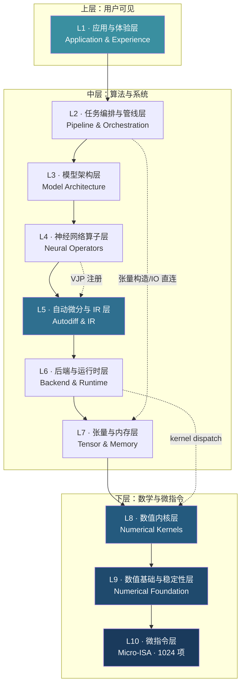
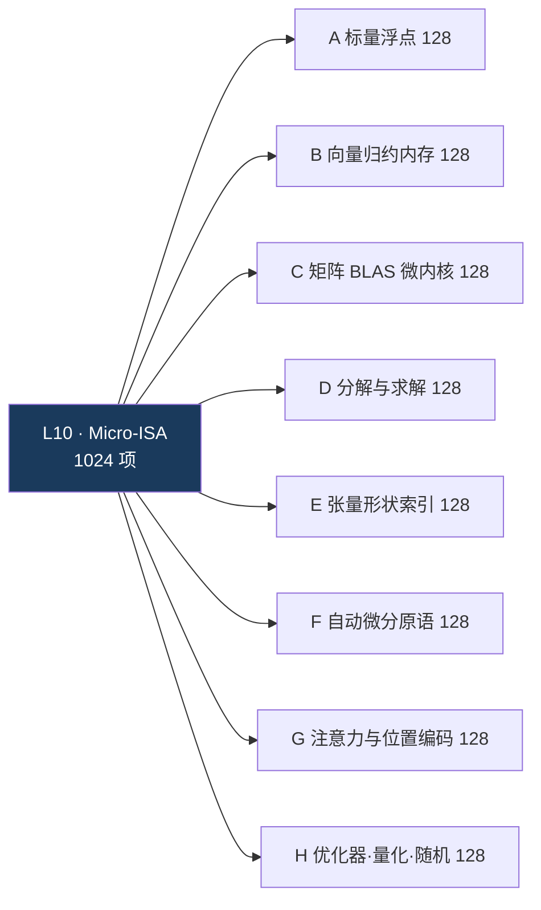
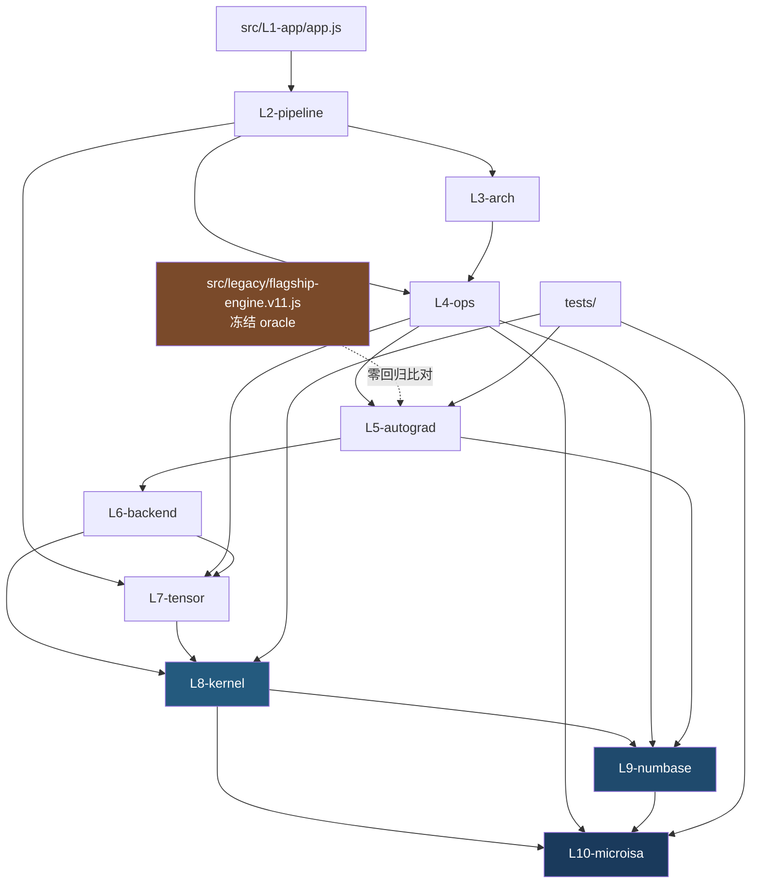

# Flagship AI · 产品需求文档（PRD v12）

> **继承 v11.0 · 零重写 · 集大成 · 闭环交付** —— 把一份成熟单体重构为世界顶级成果之上的十层分解架构
> 作者：晨星（Chenxing）· GitHub: [CJX0712/flagship-ai](https://github.com/CJX0712/flagship-ai) · License: MIT

---

## 0. 文档元信息

| 项 | 值 |
|---|---|
| 文档语言 | 中文（术语/项目名保留英文） |
| Programming Language | JavaScript（ES2018+），**运行时零依赖**；构建/校验工具链允许 devDependency |
| 目标仓库 | `flagship-ai` — https://github.com/CJX0712/flagship-ai （公开仓库） |
| **当前基线版本** | **v11.0**（Gemma 2 稳定化组件：QK-norm + logit soft-cap）· `package.json` version 11.0.0 |
| **本 PRD 目标版本** | **v12.0 — 十层分解架构（10-Layer Decomposition Architecture）** |
| 许可证 / 署名 | MIT · 晨星（Chenxing） |

---

## 0.1 项目现状基线（v11.0 · 全部实测，非推测）

> ⚠️ **前提修正记录**：初版任务书称"工作区完全空白、全新起盘"。**实测不成立**。工作区已存在成熟资产，本 PRD 全线改为「**接管成熟资产做 v12.0 十层架构升级**」。

### 0.1.1 版本演进史（git log 实录）

| 版本 | commit | 内容 |
|---|---|---|
| v1.0 | `bf11c5d` | 零依赖纯 JS 手写 GPT 引擎，10 项自检全绿 |
| v2.0 | `1db0ddc` | KV Cache 增量推理（提速 **58.8x**）+ 模型持久化 + 12 项自检 |
| v3.0 | `c6a00b2` | 模块化架构（LN/RMSNorm · GELU/SwiGLU · learned/RoPE）+ BPE 分词器 + 架构预设 |
| v4.0 | `df2cc2b` | GQA 分组查询注意力（LLaMA-2/3 标准组件） |
| v5.0 | `39dd50c` | INT8 权重量化推理（weight-only PTQ，LLM.int8/AWQ 谱系） |
| v6.0 | `7630e56` | 统一基准报告 `bench.js` + CI 门禁闭环 |
| v7.0 | `6614c03` | MoE 混合专家（Mixtral/DeepSeek 稀疏架构）+ 负载均衡辅助损失 |
| v8.0 | `870d49d` | MoE × INT8 组合 + CI 基准产物上传 |
| v9.0 | `a318567` | SWA 滑动窗口注意力（Mistral/Gemma 谱系） |
| v10.0 | `335c4a4` | 层交错稀疏注意力（Gemma 2/3 局部/全局模式） |
| **v11.0** | `3276f79`（HEAD） | **Gemma 2 稳定化组件 — QK-norm + logit soft-cap** |

### 0.1.2 文件资产

| 文件 | 规模 | 说明 |
|---|---|---|
| `src/flagship-engine.js` | 69 KB / **1571 行** | 核心引擎（零依赖单文件）：Tokenizer/BPE、GPT-2/LLaMA/GQA/MoE/SWA/Gemma 多架构、手写反向、AdamW、KV Cache、INT8 PTQ、持久化 |
| `src/verify.js` | 16.7 KB / 347 行 | **12 项自检套件**（Node + 浏览器双端） |
| `src/app.js` | 15.6 KB / 364 行 | demo 应用逻辑 |
| `demo.html` | 116–119 KB | 构建产物（`scripts/build-demo.js` 内联全部代码），**`file://` 双击即跑** |
| `src/corpus.js` | 27 行 | 默认中文语料 |
| `scripts/probe-*.js` | **8 个** | v3 / v4-gqa / v5-quant / moe / moe-quant / swa / gemma / gemma2 |
| `scripts/bench.js` | 243 行 | 统一基准报告 → `docs/BENCHMARK.md` |
| `docs/ARCHITECTURE.md` | 30 KB | 公式 · 复杂度 · 反向传播推导 · 参照实现对照 |
| `docs/BENCHMARK.md` | — | 自动生成的基准报告（CI artifact） |
| `.github/workflows/ci.yml` | — | Node 20/22 矩阵：verify → probes → bench |

> 关于探针数量：README 与 CI 中常表述为"7 个架构探针"，实测 `ls scripts/` 为 **8 个**（`probe-v3 / v4-gqa / v5-quant / moe / moe-quant / swa / gemma / gemma2`）。**本 PRD 一律按 8 个计**，红线要求 8 个全绿。

### 0.1.3 12 项自检清单（v11.0 · 实测全绿）

| # | 检查项 | 实测结果 |
|---|---|---|
| 1 | RNG 确定性与均匀性 | 同种子逐位一致，取值 [0,1)（mulberry32） |
| 2 | Softmax 行和 = 1 且全正 | 行和偏差 **2.22e-16**（机器精度） |
| 3 | LayerNorm 归一化不变量 | xhat 均值 **8.33e-17**；Y=g·xhat+b 偏差 **0** |
| 4 | GELU 导数数值一致性 | 解析 vs 中心差分 **5.85e-10** |
| 5 | 因果掩码不变量 | 过去位置 logits 变化 **0**；上三角注意力 = 0 |
| 6 | **中心差分梯度检验** | 395 参数，最大 err/tol = **4.22e-4**（阈值 1.0） |
| 7 | 过拟合：小语料可背熟 | loss **2.917 → 0.0011**（阈值 <0.1） |
| 8 | 随机批次训练收敛 | 前 30 步均值 2.463 → 后 30 步 0.036 |
| 9 | 生成确定性与健壮性 | 同种子一致 ✓ 贪心 ✓ 120 字 prompt ✓ 空 prompt ✓ |
| 10 | Tokenizer 编解码往返 | encode∘decode = id，未知字符跳过 |
| 11 | **KV Cache 与全序列前向逐位一致** | 末位 logits 差异 **0**；10 步贪心逐位一致 |
| 12 | 模型持久化 save/load 无损往返 | 参数差 **0**，logits 差 **0**，再序列化一致，词表恢复 |

**扩展不变量（各版本探针实测，均为回归下限）**：

| 不变量 | 实测 |
|---|---|
| RoPE 相对位置不变性 | **1.33e-15** |
| QK-norm 恒等式 `ss/dh+eps = 1/rstd²` | **6.4e-16** |
| MoE 路由+专家梯度（top-k 稳定时）err/tol | **1.1e-3**；负载均衡 aux 梯度 **8.3e-6** |
| MoE 负载均衡效果 | 坍缩 aux=3.59 → 均衡 aux=**1.02** |
| SWA / 层交错梯度检验 err/tol | **5.2e-4** |
| SWA 窗口局部性 | 超窗扰动对末位 logits 影响 **逐位 0** |
| QK-norm / logit soft-cap 梯度 err/tol | **1.4e-3 / 6.5e-3** |
| logit soft-cap 削峰效果 | 训练后 max\|logit\| 6.05 → 1.46（cap=1.5） |
| INT8 量化保真 | logits maxΔ **<0.03**；KV 末位 Δ=0；存档往返 Δ=0 |

### 0.1.4 性能基线（回归下限，不得变差）

| 指标 | 实测 |
|---|---|
| KV Cache 增量解码 | **28.5x**（64 token）/ **58.8x**（200 token）· **1739 token/s** |
| 浏览器端（12 万参数） | **2996 token/s**（80 token / 27ms） |
| INT8 权重量化 | 内存 **6.9x** / 存档 **5.6x**（JSON 5.67x）、in-RAM 线性 8x |
| 参数对齐架构对照 | 同语料/同种子/同步数：llama 准确率 47.6% > gpt2 34.9% |

**两条已被实测否决的路线（v11 的工程资产，禁止重复投入）**：

| 路线 | 实测 | 结论 |
|---|---|---|
| 手写 4 路循环展开 | 32.7µs vs 30.2µs（**更慢**） | V8 已把朴素循环优化到标量极限 ~900M MAC/s |
| Int8 **计算**量化（llama.cpp 路线） | **0.92x**（无加速） | JS 无 SIMD intrinsics，量化收益来自 C++ SIMD，JS 拿不到 |
| INT8 **权重**量化（仅压缩，v5.0） | 存档 5.6x / 内存 6.9x | ✅ 有效，保留 |

---

## 0.2 本 PRD 的主线

```
v11.0（69KB / 1571 行单体，能力已强但层次未分）
        │
        │  继承 · 零重写 · 逐位零回归
        ▼
v12.0（十层分解：L1 应用 … L10 微指令 1024 项）
        │
        ├─ 现状代码 → 十层映射（§B0）
        ├─ v11 能力 vs 世界 SOTA 差距清单（§A8）
        ├─ 1024 微指令：10% 从现有引擎下沉 + 90% 新增（§B4）
        └─ 红线：verify.js 12/12 不退化 + 8 个探针不回归（§C4-P0-0）
```

**一句话**：不造新 GPT，而是把已经能跑、能验证的 v11 **拆成世界顶级方案可插拔的十层架构**，并补上它缺的那一半（IR、后端、分页 KV、online-softmax、SOTA 优化器、1024 项可验证微指令）。

## 0.3 三铁律在本 PRD 的落地方式

| 铁律 | 落地机制 |
|---|---|
| **零重写** | §A1–A7 给出 7 个方向的世界最优解；§A8 差距清单逐项判定「已达 SOTA / 需替换 / 缺失 / 刻意不做」；§A9 复用矩阵登记每项 `依赖 / 移植 / 参考` |
| **集大成** | §B2 十层表逐层写明「复用什么 vs 自研什么」；§B0 现状映射表确保每一行现有代码都有归宿，不丢一分资产 |
| **闭环交付** | §C4-P0-0 红线；每层自带 verify 探针 + 不变量断言；CI 从 v11 的 12 项升级为「12 项系统自检 + 1024 项微指令自检 + ML Test Score 评分卡」 |

---

# Part A — 世界最优解检索报告

> 全部条目来自实际 WebSearch + GitHub API 校验（星标/许可证为 2026-10 实测）。
> 复用方式三分类：**【依赖】** 直接引入或内联拷贝；**【移植】** 照搬算法/数据结构/协议；**【参考】** 作 oracle / 对标 / 范式，不进产物。

## A1. 数值计算与线性代数内核

| # | 项目 | 链接 | License | 星标 | 核心能力 | 为什么是当下最优 | **我们如何复用** |
|---|---|---|---|---|---|---|---|
| 1 | **stdlib** | https://github.com/stdlib-js/stdlib | Apache-2.0 | 6.0k | JS/TS 数值标准库；含 `@stdlib/blas-base-wasm`（WASM BLAS，https://github.com/stdlib-js/blas-base-wasm）；每包独立 README/types/tests/benchmarks/REPL | Web 端**最严谨**的数值库："每个函数的误差界"是一等公民——这正是我们要的"可验证不变量"文化 | **【参考+移植】** L9 特殊函数与误差界定义对齐 stdlib；作 L10 A 域微指令的 **oracle**；WASM BLAS 仅作 CI 性能对照 |
| 2 | **ggml** | https://github.com/ggml-org/ggml | MIT | 15.5k | C 张量库，零第三方依赖；整数量化 + autodiff + optimizers；GGUF 规范 https://github.com/ggml-org/ggml/blob/master/docs/gguf.md | "零依赖张量库"形态的开创者；量化方案已成事实标准 | **【移植】** block-wise 量化表（Q4_K / Q8_0 / NF4）与 `ne/nb` 张量布局 → L8；GGUF → L2 |
| 3 | **ndarray** | https://github.com/scijs/ndarray | MIT | 1.2k | 跨步 n 维数组 `{data, shape, stride, offset}`，零拷贝视图 | Web 端 strided view 的事实标准；**正是 v11 缺失、v12 必须补的 L7** | **【移植】** L7 张量模型**直接照搬** |
| 4 | **ml-matrix** | https://github.com/mljs/matrix | MIT | 400 | 纯 JS：EVD / LU / QR / Cholesky / SVD / 求逆 | 可读的 JS 分解实现 | **【参考】** D 域分解的精度 oracle（与 forge 系列 Jacobi 1.78e-15 交叉比对） |
| 5 | **numjs-wasm** | https://www.npmjs.com/package/numjs-wasm | — | — | NumPy 兼容 API，C→WASM 的 BLAS/LAPACK/FFT/随机，600+ 函数 | npm 上 WASM 加速最完整的 NumPy 移植 | **【参考】** 仅性能对标，不引入（破坏零依赖） |
| 6 | **mathjs** | https://github.com/josdejong/mathjs | Apache-2.0 | 15.1k | 表达式/单位/符号/矩阵 | 通用数学库 | **【不复用】** 明确划出边界；仅特殊函数可作 L9 对照 |

> **检索局限**：JS 生态**没有** LAPACK 同级的生产级实现（numjs-wasm 最接近但成熟度低）。故 L8/D 域走「ggml 布局 + ml-matrix/stdlib 精度 oracle + 自研 JS」三路组合，这是当前生态下的最优解。

## A2. 自动微分与张量计算

| # | 项目 | 链接 | License | 星标 | 核心能力 | 为什么最优 | **我们如何复用** |
|---|---|---|---|---|---|---|---|
| 1 | **micrograd** | https://github.com/karpathy/micrograd | MIT | 18.0k | 标量 autograd + NN，100 行可读 | 反向模式 AD 的最小完备实现 | **【移植】** L10 μF 域 VJP 注册语义的基准；标量推广到张量 |
| 2 | **JAX** | https://github.com/jax-ml/jax | Apache-2.0 | 36.5k | 函数式变换 `grad/jit/vmap/pmap`；**JAXPR** IR；primitive-based AD | **IR-based AD 的黄金标准**：AD 不是 tape 特技而是 IR 变换，使"梯度正确性"可形式化验证 | **【移植】** L5 = 简化 JAXPR（保留 grad + jit + checkpoint，不做 vmap/pmap） |
| 3 | **tinygrad** | https://github.com/tinygrad/tinygrad | MIT | 33.8k | lazy Tensor + UOp IR + 内核融合 + BEAM 调度 + TinyJit；后端含 **WEBGPU** | 唯一同时是「框架 + 编译器 + WEBGPU 后端」且仍可通读的项目 | **【移植】** L5+L6 的**主架构模板**；`DEBUG=3/4` 打印 IR 的机制直接对应"可验证"诉求 |
| 4 | **TensorFlow.js** | https://github.com/tensorflow/tfjs | Apache-2.0 | 19.2k | `Engine` + `KernelRegistry` + `KernelBackend` 接口 + CPU/WebGL/**WebGPU**/WASM 后端 + 自动微分 | 浏览器端多后端抽象最成熟的工程范式（https://deepwiki.com/tensorflow/tfjs-core/2-core-architecture） | **【移植】** L6 的 **KernelRegistry + KernelBackend** 照搬 |
| 5 | **PyTorch** | https://github.com/pytorch/pytorch | BSD-style | 105k | tape autograd + dispatcher + gradClip/accumulation 语义 | 训练语义的事实标准；v11 的 AdamW+gradClip+续训已对齐 | **【参考】** L5 语义继续对齐 |

## A3. Transformer / 注意力机制最优实现

| # | 项目 / 论文 | 链接 | License | 星标 | 核心能力 | 为什么最优 | **我们如何复用** |
|---|---|---|---|---|---|---|---|
| 1 | **flash-attention** | https://github.com/Dao-AILab/flash-attention | **BSD-3-Clause** | 25.2k | FA 1/2/3 + Triton 实现 | 精确注意力 SOTA 内核，被 vLLM / PyTorch SDPA 采用；FA3 在 H100 上 FP16 ~740 TFLOPS（≈75% 峰值） | **【移植·仅数学】** **online-softmax 递推**（数学源头：Milakov & Gimelshein, arXiv:1805.02867）→ μG `os_*` 四件套。**明确：移植的是内存 O(N) 的数学，不是 GPU 速度** |
| 2 | **FlashMLA** | https://github.com/deepseek-ai/FlashMLA | MIT | 13.1k | MLA decode 内核 | decode 阶段的 FlashAttention；KV cache 从 `2·n_h·d_h` 压到 `4.5·d_h`（d_h=128/128 头时 ≈57×） | **【移植】** latent 压缩/解压 → `mla_compress/decompress`（P2） |
| 3 | **vLLM** | https://github.com/vllm-project/vllm | Apache-2.0 | **94.3k** | **PagedAttention**（arXiv:2309.06180）、continuous batching、CUDA graph、前缀缓存、FA3 集成 | 全球 AI 推理基础设施事实标准；KV cache 碎片浪费 **60–80% → <4%**，吞吐 2–4×（峰值 14–24×） | **【移植】** **分页 KV 块表 + CoW 共享** → L7，替换 v11 的连续预分配 |
| 4 | **ring-flash-attention** | https://github.com/zhuzilin/ring-flash-attention | (Apache-2.0) | — | Ring Attention 序列并行（arXiv:2310.01889）：KV 块通信与计算重叠 | 近无限上下文唯一可扩展方案 | **【参考+移植思想】** 浏览器端等价：多 Web Worker 分块 KV 轮转（P2） |
| 5 | 位置编码/架构论文 | RoPE [2104.09864](https://arxiv.org/abs/2104.09864) · ALiBi [2108.12409](https://arxiv.org/abs/2108.12409) · GQA [2305.13245](https://arxiv.org/abs/2305.13245) · MLA/DeepSeek-V2 [2405.04434](https://arxiv.org/abs/2405.04434) · YaRN [2309.00071](https://arxiv.org/abs/2309.00071) | — | — | 现代 LLM 标准件 | v11 已有 RoPE/GQA；**ALiBi / YaRN / MLA 尚未实现** | **【移植】** 全部实现为 L4 可开关组件 + μG 微指令，各配独立不变量 |
| 6 | **FlashInfer** | arXiv:2501.01005 | — | — | 可定制 attention engine | 推理侧 attention 最新工程化 | **【参考】** |

## A4. 推理引擎与运行时

| # | 项目 | 链接 | License | 星标 | 核心能力 | 为什么最优 | **我们如何复用** |
|---|---|---|---|---|---|---|---|
| 1 | **llama.cpp** | https://github.com/ggml-org/llama.cpp | MIT | **131.8k** | 纯 C/C++ 零依赖推理；1.5–8bit 量化；CUDA/Metal/Vulkan；定义 **GGUF** | 端侧 LLM 推理事实标准；Ollama/LM Studio/Jan 均构建其上 | **【移植】** GGUF 读写 + 量化表 → L2/L8；采样器语义对齐为 API 契约 |
| 2 | **WebLLM** | https://github.com/mlc-ai/web-llm | Apache-2.0 | 19.3k | 浏览器内 WebGPU LLM 引擎；OpenAI 兼容 API；artifact 按 URL 加载 | 浏览器 LLM 性能标杆：decode 吞吐比 transformers.js 高 ≈69% | **【移植+参考】** API 形态与 artifact 加载协议照搬；性能作 L6-WebGPU 对标上限 |
| 3 | **MLC LLM** | https://github.com/mlc-ai/mlc-llm | Apache-2.0 | 23.3k | Universal deployment via ML compilation（TVM） | 编译式跨平台部署代表 | **【参考】** 思路；**不引入 TVM**（不做自研编译器） |
| 4 | **ONNX Runtime** | https://github.com/microsoft/onnxruntime | MIT | 22.1k | `onnxruntime-web` 含 WASM / **WebGPU** / WebNN EP | 2025 年 npm 增速最快（+185%，月 220 万次），已超 tfjs；**EP 插槽是最干净的加速器抽象** | **【移植】** L6 **Execution Provider 插槽模型**照搬；算子语义对齐 ONNX op set |
| 5 | **transformers.js** | https://github.com/huggingface/transformers.js | Apache-2.0 | 16.4k | ~200 架构；**v4 全新 C++ WebGPU runtime**（Node/Bun/Deno 可跑）；支持 **MLA/MoE/Mamba**；`com.microsoft.GroupQueryAttention`/`MatMulNBits`/`QMoE`（MHA 提速 ~4×） | HF 生态浏览器入口，月下载 ~72 万；"为 LLM 逐算子重实现 + 专用 contrib op"是当前浏览器端性能最优解 | **【移植】** 算子命名与权重格式对齐 HF；**其 v4 三条重构策略直接照搬为我们拆 1571 行单体的方法**（monorepo / 按模型分模块 / 示例外拆） |
| 6 | **wllama** | https://github.com/ngxson/wllama | MIT | — | llama.cpp → WASM；V3 支持 WebGPU/多模态/tool calling | 浏览器端最轻 llama.cpp 路径；WASM 比原生慢 25–50% | **【参考】** 外部引擎 A/B 对照，不引入 |

## A5. 训练与优化器

| # | 项目 / 论文 | 链接 | License | 星标 | 核心能力 | 为什么最优 | **我们如何复用** |
|---|---|---|---|---|---|---|---|
| 1 | **Muon** | https://github.com/KellerJordan/Muon | MIT | 2.9k | Newton-Schulz 迭代做梯度矩阵正交化 | 首个在小规模 LM 上显著超越 AdamW 的矩阵正交化优化器 | **【移植】** `muon_ns_step`（五次迭代系数照搬） |
| 2 | **Moonlight** | https://github.com/MoonshotAI/Moonlight | MIT | 1.5k | **Muon 规模化**：① weight decay ② `0.2·√max(A,B)` 更新 RMS 对齐 ③ **ZeRO-1 风格分布式 Muon**；arXiv:2502.16982 | Moonlight-16B-A3B 用 5.7T tokens 训练，达 AdamW 同等 loss 仅需 **≈52% 算力**；MMLU 70.0 vs Llama3.2-3B 54.7 / Qwen2.5-3B 65.6 | **【移植】** 更新量公式 `η·(0.2·O·√max(A,B) + λW)` 直接实现（能否即插即用的关键） |
| 3 | **SOAP** | https://github.com/nikhilvyas/SOAP | MIT | 284 | Shampoo 预处理器**特征基**里跑 Adam；arXiv:2409.11321 | 大 batch 下比 AdamW 少 **40%+ 迭代、35%+ wall-clock**；只多 1 个超参 | **【移植】** `soap_rotate / soap_update / soap_rotate_back` 三件套 |
| 4 | **DeepSpeed** | https://github.com/deepspeedai/DeepSpeed | Apache-2.0 | — | ZeRO 1/2/3 状态分片 | 分布式显存分片标准 | **【移植思想】** 浏览器等价：跨 Worker optimizer state 分片（P2） |
| 5 | **peft** | https://github.com/huggingface/peft | Apache-2.0 | 21.8k | LoRA / QLoRA / 全谱系 PEFT | 参数高效微调事实标准 | **【移植】** LoRA `W+(α/r)·BA` + **QLoRA NF4 双重量化** |
| 6 | **trl** | https://github.com/huggingface/trl | Apache-2.0 | 19.6k | `GRPOTrainer`：GRPO + PEFT/FSDP + vLLM rollout + Liger Kernel | **GRPO 参考实现**；2025–2026 旗舰推理模型的后训练默认（DeepSeek-R1 用 GRPO，Qwen 用 GSPO） | **【移植】** GRPO 目标 + group advantage `(r−mean)/std`；**必须处理退化组**（std=0 跳过，否则梯度爆炸） |
| 7 | **open-r1** | https://github.com/huggingface/open-r1 | Apache-2.0 | 26.5k | DeepSeek-R1 完全开放复现：配方/数据集/checkpoint | 证明开源工具链可复现 R1 级效果 | **【移植】** **可验证奖励（verifier-based reward）** 范式——唯一能配"可验证不变量"的奖励形式，与本项目气质完全契合 |
| 8 | **verl / OpenRLHF** | https://github.com/agentica-project/verl · https://github.com/OpenRLHF/OpenRLHF | Apache-2.0 | 10.1k(OpenRLHF) | 分布式 RL 后训练（GRPO/GSPO/DAPO/REINFORCE++/PPO） | 大规模 RL 双雄 | **【参考】** 异步 rollout 解耦架构（P2） |
| 9 | **unsloth** | https://github.com/unslothai/unsloth | Apache-2.0 | 78.3k | Triton 高效微调内核 + GRPO | 单卡微调性能天花板 | **【参考】** 性能上限对标 |
| 10 | AdamW / Lion | arXiv:1711.05101 · Lion arXiv:2302.06675 | — | — | v11 已实现 AdamW(β1=0.9, β2=0.95) + 解耦 wd + gradClip + warmup + cosine | — | 保留 + 新增 Lion |

## A6. 验证与可复现性最佳实践

| # | 资源 | 链接 | License | 核心内容 | **我们如何复用** |
|---|---|---|---|---|---|
| 1 | **fast-check** | https://github.com/dubzzz/fast-check | MIT（5.2k★） | JS/TS 性质测试：arbitrary 组合、**自动 shrinking** 到最小反例、**可复现 seed**；6 类规范性质：往返/幂等/交换律/不变量/oracle 对比/蜕变关系 | **【依赖·devDep】** L10 每项微指令必须有性质测试 |
| 2 | **The ML Test Score** | https://research.google/pubs/archive/aad9f93b86b7addfea4c419b9100c6cdd26cacea.pdf | — (Breck et al., 2017) | **28 项可执行测试**评分卡：特征与数据 / 模型 / ML 基础设施 / 生产监控；每项 0 / 0.5 / 1 分 | **【移植】** 改造为 `docs/SELF-ASSESS.md`。v11 现状估约 12–14 分（基础设施强、监控弱）；v12 目标 ≥20 |
| 3 | **On Testing ML Programs** | https://arxiv.org/abs/1812.02257 | — | 梯度检验（Karpathy 7 条实操：double precision / 避开 kink / 少样本 / 少维度 / 关 dropout 与正则 / 保持浮点活跃区间）、property-based、metamorphic、mutation testing | **【移植】** v11 已在做（4.22e-4 完全符合其规范）；v12 升格为 L10 每项的**强制测试契约**，并补蜕变测试与变异测试 |
| 4 | **PyTorch Reproducibility** | https://pytorch.org/docs/stable/notes/randomness.html | — | 种子、nondeterministic 算子清单、determinism | **【参考】** 确定性重放协议；v11 的 mulberry32 是好起点，补 PCG64/Philox + JAX 式 `rngSplit` |
| 5 | **Diátaxis** | https://diataxis.fr/ | CC BY-SA | 文档四象限：**Tutorial / How-to / Reference / Explanation** | **【移植】** `docs/` 四象限改造 |
| 6 | **Model Cards** | arXiv:1810.03993 | — | 预期用途、局限、失效模式 | **【移植】** 每个 checkpoint 配 `MODEL_CARD.md` |
| 7 | 环境锁定 / 声明式 DAG | https://public-pages-files-2025.frontiersin.org/journals/physics/articles/10.3389/fphy.2025.1711356/pdf | — | 环境规格 + 容器；Snakemake/Nextflow；数据哈希 + 种子日志 + artifact 归档 | **【参考】** CI 固化 Node 版本矩阵 + 语料哈希 + seed（v11 已做，加强） |

## A7. AI 系统架构的开源范式参考

| # | 项目 | 链接 | License | 星标 | 可借鉴的范式 | **我们如何复用** |
|---|---|---|---|---|---|---|
| 1 | **nanoGPT** | https://github.com/karpathy/nanoGPT | MIT | **64.0k** | 极简扁平 `train.py/model.py/configurator.py`；README 直接给"3 分钟 CPU 训练"可复制命令；Poor Man's Configurator（exec 配置 + `--key=value` 覆盖，严格类型检查） | **【移植】** v11 的 `applyPreset` 已是同精神，v12 升级为**十层配置器** |
| 2 | **nanochat** | https://github.com/karpathy/nanochat | MIT | — | nanoGPT 官方指明的**继任者**（2025-11 起） | **【参考】** 跟踪其方向，避免走已被作者放弃的路线 |
| 3 | **llm.c** | https://github.com/karpathy/llm.c | MIT | 31.2k | **纯 C/CUDA 无依赖训练 GPT-2**；教学可通读与真实性能兼得 | **【移植】** 零依赖哲学样板；"一步步优化、每步可复现"的 README 结构 → `docs/how-to/optimize.md` |
| 4 | **tinygrad** | https://github.com/tinygrad/tinygrad | MIT | 33.8k | 目录 `docs/ test/ examples/ extra/ spec/`；mkdocs 站；`AGENTS.md`；pre-commit；README 顶部 3 个徽章 | **【移植】** 目录骨架 + **徽章精简原则** + `AGENTS.md` |
| 5 | **JAX** | https://github.com/jax-ml/jax | Apache-2.0 | 36.5k | `docs/` + `benchmarks/` + 严格 CHANGELOG | **【参考】** CHANGELOG 纪律（v11 commit 已很规范） |
| 6 | **transformers.js** | https://github.com/huggingface/transformers.js | Apache-2.0 | 16.4k | **v4 三条重构策略**：① pnpm workspaces ② 8000 行 `models.js` 按模型拆分 ③ 示例拆到独立仓库 + Prettier | **【移植】** **这正是我们拆 1571 行单体的方法论** |
| 7 | **stdlib** | https://github.com/stdlib-js/stdlib | Apache-2.0 | 6.0k | 每包自带 README/types/examples/benchmarks/tests/REPL；`CITATION.cff`、`SECURITY.md`、`CONTRIBUTORS` | **【移植】** "每层/每包一档"的文档与测试纪律 = "文档最全"的工程化答案 |
| 8 | Diátaxis + Google Rules of ML | https://diataxis.fr/ · https://developers.google.com/machine-learning/guides/rules-of-ml | CC BY-SA / — | 文档四象限；ML 工程规则 | **【移植】** `docs/` 四象限 + 设计原则固化 |

---

## A8. 差距清单（Gap Analysis）· v11.0 vs 世界 SOTA

> 这份表是「零重写 / 集大成」真正的落地形态：**已达 SOTA 的锁死不动，该换的换，缺的补，已被实测否决的永不重投**。

### A8.1 ✅ 已达 SOTA —— 锁死保留（v12 只做"下沉分层"，不改算法）

| 能力 | v11.0 现状 | 世界 SOTA 参照 | 判定 |
|---|---|---|---|
| Decoder-only pre-LN Transformer 骨架 + 权重共享输出头 | 已实现 | GPT-2 / nanoGPT | 已达 |
| RMSNorm / SwiGLU / RoPE | 已实现，各有独立梯度检验 | LLaMA / Mistral | 已达 |
| GQA（nKvHead 分组映射 + KV cache 同步压缩） | 已实现 | LLaMA-2/3（arXiv:2305.13245） | 已达 |
| MoE（top-k 路由 + 负载均衡 aux loss，坍缩 3.59→1.02） | 已实现，手写前后向 | Mixtral / Switch / DeepSeek | 已达 |
| SWA + 层交错局部/全局（Gemma 2/3） | 已实现，窗外影响逐位 0 | Mistral / Gemma 2 | 已达 |
| QK-norm + logit soft-cap | 已实现，恒等式误差 6.4e-16 | Gemma 2 | 已达 |
| **手写反向传播 + 中心差分梯度检验** | 395 参数 err/tol **4.22e-4** | arXiv:1812.02257 / Karpathy 规范 | **已达且高于常见开源**（多数项目无此项） |
| AdamW + 解耦 wd + 全局 gradClip + warmup + cosine + 断点续训 | 已实现 | PyTorch 语义 | 已达 |
| KV Cache 增量解码（58.8x / 1739 tok/s） | 已实现 | llama.cpp 同类思想 | 已达（**内存管理落后，见 A8.2**） |
| INT8 weight-only PTQ | 已实现，logits Δ<0.03 | LLM.int8 / AWQ 谱系 | 已达（**粒度落后，见 A8.2**） |
| BPE（GPT-2 字节级 + 字符级双基元，往返无损） | 已实现 | tiktoken | 已达 |
| 模型持久化（参数+词表+tokenizer 类型+merges，Δ=0） | 已实现 | 自研，无对标必要 | 已达 |
| **零运行时依赖 + 浏览器 `file://` 双击即跑** | 已实现 | llm.c 精神在 JS 的对应物 | 已达，且是**独特优势** |
| CI 门禁（Node 20/22 → verify → probes → bench + artifact） | 已实现 | — | 已达 |

### A8.2 🔄 需替换为更强现成方案 —— v12 的核心改造项

| # | 能力 | v11.0 现状（劣势） | 更强现成方案 | v12 动作 | 收益 |
|---|---|---|---|---|---|
| G1 | **KV Cache 内存管理** | 连续预分配 `blockSize×D`，满后 `kvShift` 用 `copyWithin` 整体平移；多序列/长上下文必浪费 | **vLLM PagedAttention**（块表 + CoW 前缀共享，arXiv:2309.06180） | 替换为**分页 KV**：`kv_page_alloc/free/gather_block` | 碎片 **60–80% → <4%**；同前缀多序列共享物理块 |
| G2 | **注意力实现** | 物化 `T×T` scores 矩阵（`new Float64Array(T*T)`，L911），内存 **O(N²)** | **online-softmax**（FlashAttention 的数学源头 arXiv:1805.02867） | 新增 `os_init/os_update/os_rescale/os_finalize` 四件套 + 分块；朴素版保留为 oracle | 内存 **O(N²) → O(N)** |
| G3 | **张量表示** | 裸 `Float64Array` + 手写 `i*c+j` 索引；**无 stride、无视图、无 dtype** | **ndarray `{data,shape,stride,offset}`**（MIT） | 新增 **L7**，零拷贝 `view/permute/slice` | 转置/切片零拷贝；为 L6 后端抽象奠基 |
| G4 | **优化器谱系** | 仅 AdamW | **Muon/Moonlight**（≈52% 算力）、**SOAP**（−40% 迭代）、Lion | 新增 μH 域优化器；Muon 只需 matmul，纯 JS 可跑 | 训练效率对标 2025 SOTA |
| G5 | **量化粒度** | INT8 仅 per-tensor absmax（`Math.round(d[i]/scale)`） | **ggml block-wise Q4_K / Q8_0** + **QLoRA NF4 双重量化** | 升级为 block-wise + NF4 | 更低比特下保真更好；支撑 QLoRA |
| G6 | **随机性** | `mulberry32`（L30）+ `train` 内联 LCG（L1162）——**不可派生、跨层重放弱** | **PCG64 / Philox**（NumPy 命名）+ **JAX 式 `rngSplit` key 派生** | 新增可派生 RNG + 显式 RNG stream 注入 | 第 N 步随机状态可精确重建 |
| G7 | **模型格式** | 自有 JSON 存档（无损但封闭） | **GGUF**（llama.cpp）+ SafeTensors/ONNX（HF） | L2 新增 GGUF 读 + SafeTensors 互操作 | 接入全球模型生态 |
| G8 | **架构开关形态** | if-else 条件分支散落在 `forward`/`backward` | **组件注册表**（tfjs `KernelRegistry` / ORT `Execution Provider`） | 改为**注册式** L4 算子 + L6 后端插槽 | 新增架构零改动上层 |
| G9 | **反向传播形态** | 整体手写 `GPTModel.backward()`（≈400 行） | **IR-based AD**（JAX JAXPR） | **新增 IR 路径**（L5），手写版**保留为 oracle**，二者必须数值等价 | 梯度正确性可形式化验证；支撑自动融合 |

### A8.3 ❌ 缺失 —— v12 新增能力

| 能力 | 世界 SOTA 参照 | 优先级 |
|---|---|---|
| 自动微分 IR / 计算图（简化 JAXPR + grad/jit/checkpoint） | JAX | **P0/P1** |
| 后端抽象（KernelBackend + Registry + EP 插槽） | tfjs / ORT | **P0/P1** |
| WebGPU（WGSL compute）可选后端 | WebLLM / transformers.js v4 / ORT WebGPU EP | P1 |
| online-softmax 分块注意力 | FlashAttention 数学 | P1 |
| 分页 KV Cache | vLLM PagedAttention | P1 |
| ALiBi / YaRN / MLA 位置与压缩 | arXiv:2108.12409 / 2309.00071 / 2405.04434 | P1–P2 |
| Muon / Moonlight / SOAP / Lion 优化器 | KellerJordan/Muon、MoonshotAI/Moonlight、nikhilvyas/SOAP | P1 |
| GRPO + 可验证奖励（含退化组守卫） | trl `GRPOTrainer`、open-r1 | P1 |
| LoRA / QLoRA | peft | P2 |
| 性质测试框架（arbitrary + shrinking + seed） | fast-check | **P0** |
| 分解算法（Jacobi EVD / QR / Chol / SVD / LU） | ml-matrix + 用户既有 forge 系列 | P2（D 域） |
| 误差补偿求和（Kahan / Neumaier / two_sum） | stdlib 误差界 | **P0**（A 域） |
| 文档体系（Diátaxis 四象限 + ML Test Score 评分卡） | Diátaxis / Google | **P0** |
| 1024 项微指令本体 | 自研（无对标，这是我们的原创资产） | **P0 起分批** |

### A8.4 🚫 刻意不做 —— 已实测否决或有更强现成方案（永不重投）

| 路线 | 否决依据 |
|---|---|
| 手写循环展开 / 手工 SIMD | **实测更慢**（32.7µs vs 30.2µs）—— V8 已把朴素循环优化到标量极限 ~900M MAC/s |
| Int8 **计算**量化（llama.cpp 路线） | **实测 0.92x**（无加速）—— JS 无 SIMD intrinsics |
| 自研 GPU 编译器 / codegen | MLC-LLM / TVM 的领地（铁律 2：凡有更强现成方案，立即替换自写） |
| 引入 NumPy 式重依赖（numjs-wasm 等） | 破坏零依赖招牌；仅作 CI 性能对照 |
| Python 侧对照实现 | 梯度正确性用**中心差分自证**即可，无需外部参照 |
| 通用数学库能力（表达式解析 / 单位 / 符号计算） | mathjs 领地，不在射程 |

---

## A9. 复用矩阵总表（铁律 1&2 的落地台账）

| 层级 | 移植自（现成方案） | 自研（我们的增量） | 仅参考（不进产物） |
|---|---|---|---|
| L1 应用 | WebLLM OpenAI 兼容 API 形态；nanoGPT 快速上手范式 | 十层自检面板、架构图可视化 | — |
| L2 管线 | ggml/GGUF + SafeTensors；llama.cpp 采样器；Moonlight 分布式 Muon；trl GRPO；open-r1 可验证奖励；peft LoRA/QLoRA | 可复现训练协议（seed+语料哈希+step 快照）、GRPO 的 JS 实现、微指令级训练轨迹录制 | DeepSpeed ZeRO；verl/OpenRLHF |
| L3 架构 | DeepSeek-V2 MLA；GQA；YaRN；Switch 均衡；nanoGPT 配置器 | 预设 → 十层配置展开；MLA 块组装 | transformers.js 模型集 |
| L4 算子 | FlashAttention online-softmax（1805.02867）；FlashMLA latent；Gemma2 QK-norm/soft-cap（v11 已有） | 算子注册表 + 组合式架构开关；MLA/ALiBi/YaRN | FlashInfer；com.microsoft.* |
| L5 自动微分 | micrograd VJP 语义；**JAX JAXPR**；tinygrad 惰性+融合 | 简化 JAXPR 的 JS 实现；`grad/jit/checkpoint`；IR 与手写反向的等价证明 | PyTorch tape |
| L6 后端 | **tfjs KernelBackend/Registry**；**ORT EP 插槽** | CPU(JS) 默认后端；WebGPU(WGSL) 可选后端；能力自省与降级 | TVM / MLC 编译器 |
| L7 张量内存 | **ndarray stride/offset 四元组**；**vLLM 块表 + CoW**；ggml `ne/nb` | **分页 KV Cache**（替换连续预分配）；stride 视图系统；arena 分配器 | — |
| L8 数值内核 | ggml 量化表 Q4_K/Q8_0/**NF4**；ml-matrix 分解结构 | 分块 GEMM；NF4 双重量化；分解实现 + 残差不变量 | stdlib WASM BLAS；numjs-wasm |
| L9 数值基础 | stdlib 误差界；PyTorch 确定性规范；PCG64/Philox；JAX `rngSplit` | **确定性重放协议**；ULP 误差预算表；Kahan/Neumaier；NaN/Inf 哨兵 | ReproZip |
| L10 微指令 | Muon Newton-Schulz；Moonlight `0.2·√max(A,B)`；SOAP 旋转三件套；online-softmax 递推 | **1024 项本体 + 每项不变量/性质测试** | — |
| 仓库/文档 | Diátaxis 四象限；ML Test Score 28 项；**transformers.js v4 三条重构策略**；tinygrad 目录骨架+徽章原则 | `AGENTS.md`、分层测试命令、SELF-ASSESS 评分卡 | nanochat |

---

# Part B — 十层分解架构（v12 核心）

## B0. 现状 → 十层映射表（`flagship-engine.js` 69KB / 1571 行）

> 每一行现有代码都有明确归宿。**没有任何一行被丢弃** —— 这是"零重写"的逐行证明。

| 现有符号 / 段落 | 行号 | 现状归属（混乱处） | → v12 层 | 重构动作 |
|---|---:|---|---|---|
| `mulberry32` / `randn` | 30–49 | 数基（正确） | **L9** → μH `rng_*` | 迁移保留 + 新增 PCG64/Philox/`rngSplit` |
| `matmul` / `matmulAtB` / `matmulTA` / `matmulQ` / `matmulAtBQ` / `mm` / `mmAtB` | 51–129 | 算子与数基**混在一起** | **L8** → μC `gemm_*` | 提炼为 μC 域；补分块/pack/micro-panel/NF4 GEMM |
| `addInto` / `rowSumInto` | 134–144 | 算子 | **L10** → μB 向量归约 | 下沉 |
| `layernormFwd/Bwd` | 146–189 | 算子 | **L4** 算子 + μF `vjp_layernorm` | 前向留 L4，VJP 下沉 |
| `geluFwd/Bwd` / `siluF` / `GELU_C` | 191–214 | 算子 | μA（`gelu_tanh/silu`）+ μF | 标量部分 μA |
| `rmsnormFwd/Bwd` | 216–256 | 算子 | **L4** + μF `vjp_rmsnorm` | 同上 |
| `qkNormFwd/Bwd` | 258–299 | 算子 | **L4** + μF `vjp_qknorm` + μG `qk_norm_head` | 同上 |
| `swigluFwd/Bwd` | 301–327 | 算子 | **L4** + μF `vjp_swiglu` | 同上 |
| `ropeApply` / `ROPE_BASE` | 329–359 | 算子 | **L4** + μG `rope_*` | 保留；补 `yarn`/`ntk`/`alibi`/`rope_decoupled` |
| `softmaxRows` / `softmaxBwd` | 361–385 | 算子 | **L4** + μG `os_*` 四件套 | **朴素版保留为 oracle**，新增 online-softmax |
| `topkRows` | 387–405 | 算子（MoE 与采样共用） | μH `topk_filter` | 下沉为共享原语 |
| `moeForward` / `moeBackward` | 407–493 | **模型层里写算子** | **L3** 架构组装 + **L4** 路由/专家算子 + μF `vjp_topk_gating` | 拆开：aux loss 留 L3，路由/专家数学下沉 |
| `crossEntropy`（含 max-subtract 稳定化） | 495–518 | 算子 | **L4** + μF `vjp_cross_entropy` | 保留并下沉 |
| `Tokenizer` / `BPETokenizer` / `BYTE_ENC` / `BYTE_DEC` / `PRE_RE` / `textToByteChars` | 519–695 | **应用层里写数据管线** | **L2**（`L2-pipeline/tokenizer/`） | 迁出引擎 |
| `GPTModel` 构造 + 参数初始化（`add`/`zeros`/`ones`/`rscale`） | 697–841 | 模型 | **L3** | 预设与初始化留 L3 |
| `GPTModel.quantize()`（INT8 per-tensor） | 833–863 | 模型 | **L8** + μH `quant_*` | 升级为 block-wise + NF4 |
| **`GPTModel.forward()`**（嵌入→L×Block→LNf→logits） | 865–1020 | **模型 + 算子 + 数基三层混写**（最大块） | **L3** 编排 + **L4** 逐算子调用 + **L7** 张量 | **必须拆**：编排留 L3，算子下沉 L4 |
| **`GPTModel.backward()`**（整体手写反向） | ~1021–1141 | 模型 | **L5 的黄金 oracle** + μF 逐项 VJP | **保留为 oracle**，新增 IR 路径与之等价 |
| `train`（AdamW β1=0.9/β2=0.95 + warmup + cosine + gradClip + 断点续训） | 1142–1236 | **管线里写优化器** | **L2** 编排 + μH `adamw_step`/`lr_*`/`clip_grad_norm` | 编排留 L2，逐步数学下沉 μH |
| `initKVCache` / `forwardStep` / `warmupKV` / `kvShift` | 1237–1380 | 推理 | **L2** 生成编排 + **L7 分页 KV** | `kvShift`(copyWithin) → `kv_page_alloc/free/gather` |
| `saveModel` / `loadModel` / `loadTokenizer` | 1392–1455 | 持久化 | **L2**（格式层） | 保留 + 新增 GGUF/SafeTensors |
| `generate`（temperature / top-k / top-p / 种子） | 1456–1539 | 应用+管线 | **L2** 采样编排 + μH `topk/topp/gumbel_max` | 采样语义对齐 llama.cpp |
| `ARCH_PRESETS` / `applyPreset` | 1541–1559 | 配置 | **L3** 预设 → **十层配置器** | 升级 |
| `src/app.js` + `demo.html` | — | 应用 | **L1** | 迁移 |
| `src/verify.js`（12 项） | — | 验证 | **L0 门禁**（跨层） | 保留并升级 |
| `scripts/probe-*.js` × 8 | — | 验证 | 分层回归套件 `tests/` | 迁移 |
| `scripts/bench.js` + `docs/BENCHMARK.md` | — | 验证 | 保留 | 保留并扩展 |
| **外部既有资产**：forge 系列（pca/gmm/nn/attn-forge，Jacobi 1.78e-15） | — | 仓库外 | **D 域** + L8 | 并入，作 μD/μC 既有实现 |
| **外部既有资产**：《AI 大全》知识库 | — | 仓库外 | **L10 文档模板**（§B3.1） | 单向落盘 |

### B0.1 三个最危险的拆分点（必须特别小心）

| 风险点 | 为什么危险 | 缓解 |
|---|---|---|
| `GPTModel.forward()`（~155 行） | 模型编排、算子数学、张量索引三层混写，拆错即引入数值差异 | 先**逐行等价搬运**（不改任何算式），跑通零回归后再做抽象 |
| `GPTModel.backward()`（~120 行） | 手写反向是 v11 最值钱的资产（4.22e-4） | **冻结为 `src/legacy/` oracle**，IR 路径与之逐位比对（不是替换，是**并行验证**） |
| `train()` 里的内联 RNG（L1162–1167） | 批次采样序列一旦改变，loss 曲线与"断点续训逐位等价"就破坏 | RNG 抽象必须**逐位复现 mulberry32 序列**，作为 μH 的回归用例 |

## B1. 架构总览



**依赖规则（硬约束）**：第 N 层只能调用第 N+1..10 层；禁止反向依赖、禁止跨层跳跃（L2 直连 L7 仅限张量构造/IO，不参与计算路径）。

## B2. 十层定义表

| 层 | 层名 | 职责边界 | 输入 → 输出契约 | v11 现状来源 | **复用什么** | **自研什么** |
|---|---|---|---|---|---|---|
| **L1** | 应用与体验层 | UI/CLI/可视化/文档入口；**不做数学** | 用户事件 → L2 API → DOM/终端 | `app.js` + `demo.html` | WebLLM API 形态；nanoGPT 上手范式 | 十层自检面板、架构图可视化 |
| **L2** | 任务编排与管线层 | 训练循环、生成采样、微调/PEFT、后训练、量化导出、checkpoint、互操作格式；**不做算子** | `(model,tokens,opts,seed)` → `{history,finalLoss,state}` | `train`/`generate`/`quantize`/`saveModel`/tokenizer（L519–695, 1142–1559） | ggml/GGUF + SafeTensors；llama.cpp 采样器；trl GRPO；open-r1 可验证奖励；peft | 可复现训练协议；GRPO 的 JS 实现；微指令级轨迹录制 |
| **L3** | 模型架构层 | 层/块组装、预设、权重布局、初始化；**不做算子数学** | `cfg` → `Model{blocks,params}` | `GPTModel` 构造/初始化/`forward` 编排/`ARCH_PRESETS`（L697–841, 865–1020, 1541–1559） | DeepSeek-V2 MLA；GQA；YaRN；Switch 均衡 | MLA 块组装；预设 → 十层配置展开 |
| **L4** | 神经网络算子层 | 可组合算子，每个 = 前向 + 反向 VJP；**不做 matmul 实现** | `(Tensor,cfg) → Tensor`，并向 L5 注册 vjp | MHA/GQA/SWA/层交错/MoE/QK-norm/soft-cap/RoPE/RMSNorm/SwiGLU/GELU（L146–518） | online-softmax（1805.02867）；FlashMLA latent；ALiBi；YaRN | **算子注册表 + 组合式架构开关**（v11 是 if-else）；MLA/ALiBi/YaRN |
| **L5** | 自动微分与 IR 层 | 程序→IR；IR 变换（grad/checkpoint/融合）；**不做具体 VJP 数学** | `fn(*Tensors)` → `IRGraph`；`grad(·)` → `IRGraph'` | v11 整体手写 `backward()`（**保留为 oracle**） | micrograd VJP 语义；**JAX JAXPR**；tinygrad 惰性+融合 | 简化 JAXPR 的 JS 实现；grad/jit/checkpoint；IR↔手写反向等价证明 |
| **L6** | 后端与运行时层 | kernel 注册、后端选择、device 内存生命周期；**不做 kernel 数学** | `dispatch(op,args)` → Tensor | **v11 无此层**（全部内联） | **tfjs KernelBackend/Registry**；**ORT EP 插槽** | CPU(JS) 默认后端；WebGPU(WGSL) 后端；能力自省与降级 |
| **L7** | 张量与内存层 | Tensor 语义、零拷贝视图、分配器、**分页 KV cache**；**不做计算** | `alloc/view/permute/slice`；`kvAlloc/Append/Page/Gather` | v11 裸 `Float64Array` + `initKVCache`/`kvShift`（L1237–1380） | **ndarray 四元组**；**vLLM 块表 + CoW**；ggml `ne/nb` | **分页 KV Cache**；stride 视图系统；arena 分配器 |
| **L8** | 数值内核层 | matmul/GEMM 微内核、分解、量化-反量化；**不管浮点语义治理** | `(A,B,opts) → C`；`(W) → {q,scale}` | v11 手写 matmul 族（L51–129）+ INT8 PTQ（L833–863） | ggml block-wise Q4_K/Q8_0/**NF4**；ml-matrix 分解结构 | 分块 GEMM；NF4 双重量化；分解实现 + 残差不变量 |
| **L9** | 数值基础与稳定性层 | 浮点语义、误差补偿、RNG 与确定性重放、特殊函数、NaN/Inf 防御 | 稳定 `sum/exp/log/erf/lgamma`；`rng(seed) → stream`；`rngSplit` | `mulberry32`/`randn`（L30–49）+ train 内联 LCG（L1162） | stdlib 误差界；PyTorch 确定性；PCG64/Philox；JAX `rngSplit` | **确定性重放协议**；ULP 预算表；Kahan/Neumaier；NaN 哨兵 |
| **L10** | 微指令层 | 1024 个**不可再分**最小操作，每个带不变量断言；**不做组合逻辑** | `μop(args) → result`，纯函数、无状态、可重放 | **v11 全部混在引擎里，v12 提取** | Muon Newton-Schulz；Moonlight `0.2·√max(A,B)`；SOAP 三件套；online-softmax 递推 | **1024 项本体 + 每项不变量/性质测试**（最大自研量，也是最强差异化） |

## B3. 第十层：1024 项微指令的分组（8 域 × 128 项）

**设计原则**：不可再分（一个数学事实 + ≤30 行实现 + 一条可验证不变量）；纯函数（随机性由 L9 显式 RNG stream 注入）；可枚举（编号 `μA000–μA127`…，全局唯一、可索引、可单独测试与基准）。



| 域 | 域名 | 项数 | 编号 | 代表性微指令 | 不变量范式 |
|---|---|---:|---|---|---|
| **A** | 标量数值与浮点原语 | **128** | μA000–127 | `fma`, `two_sum`, `fast_two_sum`, `two_prod`, `kahan_step`, `neumaier_step`, `ulp_diff`, `nextafter`, `frexp`, `ldexp`, `isnormal`, `f16↔f32`, `bf16↔f32`, `round_rne`, `safe_exp`, `expm1`, `log1p`, `logsumexp_pair`, `sigmoid_stable`, `softplus`, `erf_approx`, `erfc`, `lgamma`, `hypot`, `cbrt`, `rsqrt`, `sincos_poly`, `tanh_stable`, `sech2`, `gelu_tanh`, `gelu_exact`, `silu`, `clip`, `sign` | **ULP 误差界**：每项声明 `ulp ≤ k`（对照 stdlib）；`two_sum` 满足 `a+b = s+e` 精确恒等 |
| **B** | 向量归约与内存原语 | **128** | μB000–127 | `vadd/vsub/vmul/vdiv`, `vfma`, `vsum_naive`, `vsum_kahan`, `vsum_pairwise`, `dot`, `dot_fp64`, `axpy`, `scal`, `swap`, `copy`, `memcpy_strided`, `gather`, `scatter`, `pack/unpack`, `transpose_inplace`, `lane_broadcast`, `masked_select`, `argmax`, `argmin`, `cumsum`, `prefix_scan`, `norm_l1/l2/inf`, `cosine`, `ema_inplace` | **顺序无关性**：`vsum_kahan` 对随机置换偏差 ≤1 ulp；`dot(A,B) ≡ dot(B,A)` |
| **C** | 矩阵与 BLAS 微内核 | **128** | μC000–127 | `gemm_ref`, `gemm_blocked`, `pack_a`, `pack_b`, `micro_panel_4x4/8x8`, `gemv`, `ger`, `syrk`, `trmm`, `trsm`, `gemm_nn/nt/tn/tt`, `gemm_batched`, `quant_gemm_int8`, `quant_gemm_nf4`, `dequant_row`, `absmax_rowwise`, `imatmul` | **GEMM 等价性**：分块版 ≡ 参考版（maxΔ ≤1e-12）；量化版 `‖deq(q)x − Wx‖ ≤ ε‖W‖‖x‖` |
| **D** | 线性代数分解与求解 | **128** | μD000–127 | `householder_gen`, `householder_apply`, `givens_rot`, `jacobi_rot`, `chol_lower`, `lu_pivot`, `qr_householder`, `svd_golub_kahan`, `svd_jacobi`, `eig_sym_tridiag`, `tridiag_ql_shift`, `inv_3x3`, `det_lu`, `solve_tri`, `lstsq_qr`, `mat_norm_fro`, `mat_norm_spec`, `orthogonalize_ns`, `polar_decomp`, `sqrtm_ns` | **残差不变量**：`‖Av−λv‖`（forge 实测 **1.78e-15**）；`‖A−LU‖`；`‖QᵀQ−I‖` |
| **E** | 张量形状与索引原语 | **128** | μE000–127 | `stride_from_shape`, `offset_linearize`, `broadcast_align`, `reshape_view`, `permute_axes`, `squeeze/unsqueeze`, `slice_dim`, `pad`, `concat`, `stack`, `repeat`, `tile`, `index_put`, `one_hot`, `arange`, `linspace`, `meshgrid`, `split_heads`, `merge_heads`, `repeat_kv`（GQA 展开）, `shape_check` | **零拷贝恒等**：`view(x).data === x.data`；`permute∘permute⁻¹ ≡ x`；reshape 前后元素序列逐位相同 |
| **F** | 自动微分原语 | **128** | μF000–127 | `vjp_add/sub/mul/div`, `vjp_exp/log/pow`, `vjp_matmul`, `vjp_conv1d`, `vjp_softmax`, `vjp_log_softmax`, `vjp_layernorm`, `vjp_rmsnorm`, `vjp_qknorm`, `vjp_attention`, `vjp_rope`, `vjp_cross_entropy`, `vjp_gelu/silu/swiglu`, `vjp_topk_gating`, `vjp_logitcap`, `tape_push/pop`, `grad_accum`, `zero_grad`, `jvp_forward`, `vjp_reverse`, `checkpoint`, `detach`, `stop_gradient`, `custom_vjp` | **中心差分梯度检验**：每项 err/tol < 1.0（基线：整体 4.22e-4、QK-norm 1.4e-3、soft-cap 6.5e-3、MoE 1.1e-3、SWA 5.2e-4） |
| **G** | 注意力与位置编码原语 | **128** | μG000–127 | `rope_build_cossin`, `rope_apply`, `rope_decoupled`, `yarn_freq_scale`, `ntk_base_scale`, `alibi_bias`, `qkv_split`, `qkv_merge`, `score_qk`, `scale_dh`, **`os_init`/`os_update`/`os_rescale`/`os_finalize`**, `causal_mask`, `sliding_mask`, `block_mask`, `kv_append`, `kv_page_alloc`, `kv_page_free`, `kv_gather_block`, `paged_attn_tile`, `mla_compress`, `mla_decompress`, `gqa_expand`, `qk_norm_head`, `logit_softcap`, `logit_softcap_bwd` | **掩码不变量**：未来位置 logits 变化 **= 0**；RoPE 相对不变性 **1.33e-15**；SWA 窗外影响逐位 0；KV 增量 ≡ 全量 Δ=0；online-softmax ≡ 朴素（Δ≤1e-15） |
| **H** | 优化器·量化·随机原语 | **128** | μH000–127 | `sgd_step`, `sgd_momentum`, `adamw_step`, `lion_step`, `muon_ns_step`, `muon_update_rms`, `soap_rotate`, `soap_update`, `soap_rotate_back`, `clip_grad_norm_global`, `weight_decay_decoupled`, `ema_update`, `lr_cosine`, `lr_wsd`, `lr_warmup`, `quant_q8_0`, `quant_q4_k`, `quant_nf4`, `dequant_*`, `blockwise_absmax`, `stochastic_round`, `fp8_e4m3`, `fp8_e5m2`, `rng_pcg64`, `rng_philox`, `rng_split`, `dropout_mask`, `gumbel_max`, `topk_filter`, `topp_filter` | Muon 正交性 `‖OᵀO−I‖≤1e-6`；`rng(seed)` 逐位可复现；量化往返误差界；采样后概率归一 |

**合计：8 域 × 128 = 1024 项。**

### B3.1 《AI 大全》知识库 → L10 文档模板（既有资产的零成本复用）

用户已有的《AI 大全》覆盖：数学基础 → 监督/无监督/强化学习 → 概率图模型 → 深度学习 → LLM/多模态，每个方法有 7 件套。**这正好就是 L10 微指令的文档模板**：

| 《AI 大全》字段 | L10 微指令落点 |
|---|---|
| 直觉 | `μXXX.intuition.md` |
| 数学核心 | `μXXX.math.md`（含公式与误差界） |
| 伪代码 | `src/L10-microisa/<domain>/μXXX.js` |
| 复杂度 | JSDoc `@complexity` + CI 基准 |
| 经典论文 | JSDoc `@ref`（arXiv/GitHub 链接，取自 Part A） |
| 常见坑 | `μXXX.pitfalls.md` |
| **可验证不变量** | `μXXX.test.js`（fast-check + 数值断言） |

> **1024 项微指令的文档不是额外负担，而是《AI 大全》已积累内容的结构化落盘。** 这是"文档最全"铁律的最短路径。

## B4. 1024 项微指令的下沉来源表（诚实核算）

> 必须说清楚：微指令层**不是**从现有引擎"拆出来的"，而是**以现有引擎为种子、大量新增**。

| 域 | 现有引擎可下沉 | 新增（来自 Part A SOTA / 自研） | 现有引擎的具体来源 |
|---|---:|---:|---|
| A 标量浮点 | **~24** | 104（+ 外部 forge/~5） | `geluFwd/Bwd`、`siluF`、`tanh`、`exp`、`sqrt`、`GELU_C`、soft-cap 的 `tanh`/`sech2`、`crossEntropy` 的 max-subtract |
| B 向量归约内存 | **~12** | 116 | `addInto`、`rowSumInto`、matmul 内层循环、`kvShift` 的 `copyWithin`、softmax 的行归约 |
| C 矩阵 BLAS | **~8** | 120 | `matmul`、`matmulAtB`、`matmulTA`、`matmulQ`、`matmulAtBQ`、`mm`、`mmAtB` |
| D 分解与求解 | **0**（引擎内无） | 128（其中 ~20 来自外部 forge 系列：pca-forge 的 Jacobi EVD、gmm-forge 的 Cholesky） | 引擎无；**forge 系列是 D 域的种子** |
| E 张量形状索引 | **~15** | 113 | QKV 三段切片（`qkvDim`/`D`/`D+KV*dh` 偏移）、`split/merge heads`、`repeat_kv`（`kvh=(h/g)|0`）、window 切片（`jLo` 计算）、`kvShift` 槽位 |
| F 自动微分原语 | **~18** | 110 | `layernormBwd`、`rmsnormBwd`、`qkNormBwd`、`geluBwd`、`swigluBwd`、`softmaxBwd`、`moeBackward`、`crossEntropy` 的 dlogits、matmul 的三个 bwd 变体 |
| G 注意力与位置编码 | **~10** | 118 | `ropeApply`、causal/window 掩码、`qkNormFwd` 的逐头归一化、scores 计算 `scale=1/√dh` |
| H 优化器·量化·随机 | **~14** | 114 | AdamW 单步（L1168–1200）、`gradClip`、`warmup`/`cosine` lr、`mulberry32`、`randn`、INT8 `quantize`、`topkRows`、采样的 top-k/top-p |
| **合计** | **≈101（≈10%）** | **≈923（≈90%）** | — |

**这份核算说明两件事**：
1. **现有引擎是"种子"而非"来源"** —— 它提供了约 100 项已经过实战验证的微指令原型（且自带 4.22e-4 级别的梯度检验基线），这是天然的正确性锚点。
2. **1024 项中约 90% 是新工作** —— 这也正是 Q2（凑数风险）必须严肃对待的原因：见 §C7-Q2 的默认处理（1024 是上界目标，不是硬 KPI）。

## B5. 模块依赖图



---

# Part C — PRD 主体

## C1. 产品目标

> **一句话**：Flagship AI v12 把已能跑、能验证的 v11 单体，**重构为零运行时依赖的十层分解架构**——「数学 → 算法 → 系统 → 应用」完整打通，**1024 项微指令每一项都有可验证不变量**，浏览器与 Node 双端一键自检、逐位可复现；让学习者能通读、研究者能验证、工程师能直接嵌入生产前端。

## C2. 目标用户画像

| # | 画像 | 核心诉求 | 我们提供 |
|---|---|---|---|
| **U1** AI 学习者 / 学生 | "我想看懂每一行在算什么"（无 GPU、无 Python） | 十层可逐层下钻的通读路径；`file://` 双击即跑 |
| **U2** AI 研究者 / 高校 | "我要能证明我的梯度是对的基座" | 中心差分梯度检验工厂（基线 4.22e-4）；Muon/SOAP/MLA 即插即用；可验证奖励驱动的 GRPO |
| **U3** 前端 / 全栈工程实践者 | "我要零后端、零 API key、可离线的推理" | 零依赖 ESM；stride 视图 + 分页 KV 控内存；INT8/NF4 把体积压 5–7× |
| **U4** 开源社区 / Recruiter | "这项目是不是真严谨？" | 12 项系统自检 + 1024 项微指令通过率 + ML Test Score 评分卡 + CI 可下载报告 + Diátaxis 文档 |
| **U5** 作者本人（晨星） | "每份工作都要沉淀为可复利资产" | 十层使每次升级只动一层；《AI 大全》→ 结构化文档的单向流水线 |

## C3. 用户故事（10 条）

1. **作为** AI 学习者，**我希望** 双击 `demo.html` 就能看到十层架构图并逐层点开源码与公式，**以便** 无需任何环境看懂一个 LLM 怎么从头算出来。
2. **作为** AI 学习者，**我希望** 每个微指令页面给出"直觉/数学/伪代码/复杂度/论文/常见坑/不变量"七件套，**以便** 学一个就真正掌握一个。
3. **作为** 研究者，**我希望** 新增自定义算子时只写前向 + VJP，框架自动跑中心差分检验并给出 err/tol 报告，**以便** 用数值证据证明新算子正确。
4. **作为** 研究者，**我希望** 直接切换 Muon / SOAP，在同语料同种子下与 AdamW 对比 loss 与算力比，**以便** 复现 Moonlight"≈52% 算力达同等 loss"的结论（toy 规模）。
5. **作为** 工程实践者，**我希望** `import { GPT } from 'flagship-ai'` 在浏览器加载 GGUF/JSON 模型并生成，**以便** 实现零后端、数据不出设备的隐私推理。
6. **作为** 工程实践者，**我希望** 长上下文走分页 KV 而非整块预分配，**以便** 多会话并发时内存从"浪费 60–80%"降到"<4%"。
7. **作为** 工程实践者，**我希望** 一键 `model.quantize('nf4')` 压到 4bit 且给出 logits maxΔ，**以便** 在移动端内存预算内塞下更大模型。
8. **作为** 开源贡献者，**我希望** 有 `AGENTS.md`/`CONTRIBUTING.md` 与分层测试命令（`npm run test:L10`），**以便** 只改一层时 30 秒内得到反馈。
9. **作为** Recruiter，**我希望** README 顶部看到"12/12 · 1024/1024 · ML Test Score 22/28"可点击徽章与 CI 链接，**以便** 30 秒判断工程严谨度。
10. **作为** 作者晨星，**我希望** 新增 SOTA 组件（如 MLA）只需在 L4 注册算子 + L10 补微指令 + L2 加预设，**以便** 上层零改动且 CI 自动证明无回归。

## C4. 需求池（增量视角）

### 🚧 P0-0 · 不可退让的红线（贯穿全部 P0 项）

| 红线 | 判据 |
|---|---|
| **R1 · 自检不退化** | `node src/verify.js` 必须 **12/12 全绿**，且 12 项实测值不得劣于 §0.1.3（梯度检验 err/tol ≤ 4.22e-4、KV Δ=0、持久化 Δ=0、softmax 2.22e-16 等） |
| **R2 · 探针不回归** | **8 个** probe 脚本（v3 / v4-gqa / v5-quant / moe / moe-quant / swa / gemma / gemma2）全部保持全绿，实测不变量不得劣化 |
| **R3 · API 兼容** | `src/index.js` 必须导出 v11 全部同名 API（同名同签名）；v12 **不允许破坏性变更** |
| **R4 · 数值零回归** | 同种子下 v11 与 v12 的训练 loss 序列与生成文本 **maxΔ = 0**（v11 冻结为 oracle 在 CI 中比对） |
| **R5 · 依赖红线** | 运行时依赖恒为 **0**；`demo.html` 构建产物不得包含任何 devDependency |

### P0 — 必须有（v12.0 十层重构 + 自检不退化）

| ID | 需求 | 验收标准 |
|---|---|---|
| **P0-1** | **十层目录重构**：1571 行单体 → `src/L1-app … src/L10-microisa`，单一入口 `src/index.js` | 十个目录各自可独立 import；`src/index.js` 与 v11 API 完全兼容；**R1–R5 全部满足** |
| **P0-2** | **legacy oracle 冻结**：`src/legacy/flagship-engine.v11.js`（逐字冻结）+ CI 零回归比对脚本 | CI 中 v11 与 v12 同种子跑训练与生成，断言 loss 序列与文本 **maxΔ = 0** |
| **P0-3** | **L7 张量层**：`{data,shape,stride,offset,dtype}` + 零拷贝视图 | `view.data === x.data`；`permute∘permute⁻¹ ≡ id` 逐位；L7 测试 ≥40 项 |
| **P0-4** | **L10 微指令骨架**：8 域目录 + 编号 `μX000–μX127` + `registry.js` | `registry.size === 1024`（未实现者显式标记）；`node scripts/isa.js --stats` 打印 8 域进度 |
| **P0-5** | **A/B/C/E 四域首批 384 项**（地基四域） | 384 项全过：ULP 界、顺序无关性、GEMM 等价性、零拷贝恒等；`npm run test:L10` 报 384/1024 |
| **P0-6** | **不变量测试工厂**（fast-check） | 每个已实现微指令自动跑 100+ 随机用例；失败自动 shrinking + 打印 seed |
| **P0-7** | **12 项系统自检升为 L0 门禁** | 12/12；梯度检验不劣于 4.22e-4；KV 逐位一致 Δ=0 |
| **P0-8** | **8 个 probe 迁移到分层测试目录** | `npm run test:all` 全绿；每层可单独运行（`npm run test:L4`） |
| **P0-9** | **文档 Diátaxis 四象限 + `docs/SELF-ASSESS.md`** | `docs/{tutorial,how-to,reference,explanation}/` 各 ≥1 篇；SELF-ASSESS 目标 ≥20/28 且逐项有证据链接 |
| **P0-10** | **CI 门禁升级** | Node 20/22 矩阵：`verify(12) → 分层测试 → 8 probes → bench → legacy 零回归比对`；上传 BENCHMARK.md 与 ISA 覆盖率 |
| **P0-11** | **README 徽章与十层架构图** | 7 个徽章（版本 / 系统自检 / 微指令 x/1024 / CI / 运行时依赖 0 / License / Author）+ Mermaid 十层图 |

### P1 — 重要

| ID | 需求 | 验收标准 |
|---|---|---|
| **P1-1** | **L5 自动微分 IR**（简化 JAXPR + grad/jit/checkpoint） | IR 路径与手写反向数值等价（logits maxΔ ≤1e-12，梯度 maxΔ ≤1e-9）；`DEBUG=3` 可打印 IR |
| **P1-2** | **L7 分页 KV Cache**（PagedAttention） | 块大小 16 token；同前缀 CoW 共享；碎片 **<4%**；与连续版逐位一致 |
| **P1-3** | **online-softmax 注意力内核**（μG `os_*`） | 分块版 ≡ 朴素版 maxΔ ≤1e-15；`process.memoryUsage()` 实测证明内存 O(N) 而非 O(N²) |
| **P1-4** | **F 域 128 项自动微分原语** | 全部通过中心差分 err/tol < 1.0 |
| **P1-5** | **G 域 128 项注意力与位置编码原语** | 含 ALiBi、YaRN、`rope_decoupled`；RoPE 1.33e-15、窗外零影响、掩码零泄露全部达标 |
| **P1-6** | **Muon + Moonlight 缩放规则** | `‖OᵀO−I‖ ≤1e-6`；更新 RMS 落到 0.2±0.02；Muon vs AdamW 的 loss 对比进 BENCHMARK.md |
| **P1-7** | **L6 后端抽象 + WebGPU(WGSL) 可选后端** | `KernelBackend` 接口 + CPU 实现；WebGPU 在 Chrome 跑通 MHA 与 GEMM；无 WebGPU 自动降级且相对误差 ≤1e-5 |
| **P1-8** | **GGUF 读取器** | 解析 GGUF header/metadata/tensor，加载 Q8_0/Q4_K；与等价 JSON 模型差异 ≤ 量化误差界 |
| **P1-9** | **GRPO + 可验证奖励** | 可验证任务上 pass 率显著上升（给前后数字）；**退化组（std=0）被跳过且记日志** |
| **P1-10** | **L9 确定性重放协议** | 给定 `(seed, corpusHash, step)` 可重建第 N 步全部随机状态；跨 Node 版本逐位一致 |

### P2 — 锦上添花

| ID | 需求 | 验收标准 |
|---|---|---|
| **P2-1** | **MLA** + `mla_compress/decompress` | KV bytes/token 降至 MHA 的 <1/5；latent 重构误差在阈值内 |
| **P2-2** | **H 域剩余：SOAP / Lion / NF4 双重量化** | SOAP 比 AdamW 少 ≥20% 迭代达同等 loss；NF4 压缩比与 QLoRA 论文同量级 |
| **P2-3** | **D 域 128 项分解与求解**（含 forge 系列并入） | Jacobi 残差 ≤1e-14；pca-forge/gmm-forge 资产完整迁入 |
| **P2-4** | **Ring Attention 的 Web Worker 版** | 多 Worker 分块 KV 轮转；上下文随 Worker 数线性扩展 |
| **P2-5** | **LoRA / QLoRA** | 只存低秩适配器（< 原模型 1%）；加载后效果可测 |
| **P2-6** | **L8 分块 GEMM 性能优化** | 零依赖前提下 ≥2×；**若为负收益，如实记录为"第三条被实测否决的路线"** |
| **P2-7** | **架构可视化面板**（L1） | demo.html 内十层调用热力图 + 训练曲线 + 不变量通过率仪表盘 |
| **P2-8** | **monorepo 化（pnpm workspaces）** | 拆出 `@flagship/core` / `@flagship/isa`（照搬 transformers.js v4 策略） |
| **P2-9** | **Model Card 模板 + CITATION.cff** | 每 checkpoint 配 MODEL_CARD.md；CITATION.cff 可被 Zenodo 抓取 |
| **P2-10** | **《AI 大全》↔ L10 文档同步脚本** | 知识库 Markdown 自动生成 `μXXX.intuition/math/pitfalls.md`；反向可导出汇总 |

## C5. 关键差异化（vs nanoGPT / tinygrad / llm.c / transformers.js）

| 维度 | nanoGPT | tinygrad | llm.c | transformers.js | **Flagship AI v12** |
|---|---|---|---|---|---|
| 语言 / 依赖 | Python+PyTorch（重） | Python（轻） | C/CUDA（零依赖） | JS+ONNX RT（重） | **JS 零运行时依赖** |
| 可通读性 | ✅ | ✅ | ⚠️ CUDA 已难读 | ❌ 200 架构 | ✅ **十层可逐层下钻** |
| 可验证性 | ❌ 无测试 | ⚠️ 有 test 无不变量文化 | ❌ 无 | ⚠️ 有 CI | ✅ **1024 微指令 × 不变量 + 12 项自检 + ML Test Score** |
| 浏览器可跑 | ❌ | ⚠️ 需 Python | ❌ | ✅ | ✅ **`file://` 双击即跑** |
| 教学完整性 | ✅ | ❌ | ✅ | ❌ | ✅ **《AI 大全》七件套 → 微指令文档** |
| 注意力 SOTA | ⚠️ 朴素 | ⚠️ | ❌ | ✅ MLA/MoE | ✅ **online-softmax + 分页 KV + (P2)MLA** |
| 优化器 SOTA | ❌ AdamW | ⚠️ Adam | ❌ | ❌（推理库） | ✅ **AdamW + Muon/Moonlight + (P1)SOAP/Lion** |
| 后训练 | ❌ | ❌ | ❌ | ❌ | ✅ **(P1)GRPO + 可验证奖励** |
| 既有资产连续性 | — | — | — | — | ✅ **v1→v11 十一个版本可追溯演进** |

> **一句话**：别人做「能跑的模型」或「能读的教程」；我们做 **「能跑、能读、还能证明自己对」的十层系统** —— 1024 项微指令，每一项都有一条不可绕过的数学不变量，且**从 v1.0 到 v12.0 每一步都有 commit 可追溯**。

## C6. UI / 交互设计稿描述

保持 v11 的「单文件、`file://` 直开、无构建」硬约束：`demo.html` 新增三个面板，可视化全部用**原生 SVG/Canvas 手写**（不引图表库，否则破坏零依赖）。

### 面板 1 · 十层架构导航（左侧固定）

```
┌─ 十层架构 ──────────────┐
│ ▸ L1 应用与体验     ✓    │   ✓通过 / ⚠部分 / ✗失败 / −未实现
│ ▸ L2 编排与管线     ✓    │
│ ▸ L3 模型架构       ✓    │
│ ▸ L4 神经算子       ✓    │
│ ▸ L5 自动微分 IR    ⚠    │
│ ▸ L6 后端运行时     ✓    │
│ ▸ L7 张量与内存     ✓    │
│ ▸ L8 数值内核       ✓    │
│ ▸ L9 数值基础       ✓    │
│ ▾ L10 微指令   384/1024  │
│    A 标量  128/128 ████  │
│    B 向量  128/128 ████  │
│    C 矩阵  128/128 ████  │
│    D 分解    0/128 ░░░░  │
│    E 形状  128/128 ████  │
│    F 微分    0/128 ░░░░  │
│    G 注意    0/128 ░░░░  │
│    H 优化    0/128 ░░░░  │
└──────────────────────────┘
```
点击层 → 右侧显示职责边界、I/O 契约、复用来源（带外链）、自研内容、测试通过率、**对应的 v11 源码行号**（来自 §B0 映射表）。
点击微指令 → 七件套 + **"立即跑一次"** 按钮（浏览器内现场执行并显示实测误差）。

### 面板 2 · 不变量自检仪表盘（中部）

顶部大数字徽章：`系统自检 12/12` · `微指令 384/1024` · `ML Test Score 20/28` · `运行时依赖 0`。

| 不变量 | 理论 | v11 实测基线 | 判据 | 状态 |
|---|---|---|---|---|
| Softmax 行和 | 1 | 2.22e-16 | ≤1e-14 | ✓ |
| LayerNorm 归一化偏差 | 0 | 8.33e-17 | ≤1e-14 | ✓ |
| 因果掩码泄露 | 0 | 0 | =0 | ✓ |
| 中心差分梯度 err/tol | <1 | 4.22e-4 | <1 | ✓ |
| KV Cache vs 全量重算 | 0 | 0 | =0 | ✓ |
| RoPE 相对位置不变性 | 0 | 1.33e-15 | ≤1e-12 | ✓ |
| QK-norm 恒等式 | 0 | 6.4e-16 | ≤1e-12 | ✓ |
| SWA 窗外影响 | 0 | 0 | =0 | ✓ |
| 持久化往返 | 0 | 0 | =0 | ✓ |

底部：**一键自检** 按钮（12 项逐项点亮，与 Node 结果逐位一致 —— v11 已有行为，保留）。

### 面板 3 · 训练 / 生成工作台（右侧，v11 已有，增强）

- 语料实时编辑 → 参数量/词表即时统计
- 训练：分块不卡 UI，loss 实时曲线；新增**优化器下拉**（AdamW / Muon / SOAP）与**同种子对照模式**（两条曲线并列）
- 生成：温度 / top-k / top-p / 种子可调，实时 token/s；**架构预设下拉**（gpt2 / llama / llama-gqa / mixtral / swa / gemma）
- 导出/导入：JSON 无损存档（保留）+ (P1) GGUF 导入

## C7. 待确认问题（每条附我的默认执行方案）

| # | 开放问题 | 影响 | **默认建议（无异议即按此执行）** |
|---|---|---|---|
| **Q1** | 十层编号方向：L1=顶层 还是 L1=底层？ | 全仓库命名 | **L1 = 最上层（应用），L10 = 最底层（微指令）**。与"第十层是最底层"一致；`L10-microisa` 排末也符合直觉 |
| **Q2** | 真的要凑满 1024 项？会否注水？ | 工作量与质量 | **1024 是上界目标，不是硬 KPI**。分三批推进（v12.0: 384 → v12.1: +256 → v12.2: +384）。若某域确实凑不出 128 个**不可再分**操作，**如实下调并在 ISA 报告中说明**。宁可 912 项真实，不要 1024 项注水。绝不把组合操作降级为"微指令"凑数 |
| **Q3** | 引入 fast-check 会破坏"零依赖"招牌吗？ | 招牌一致性 | **引入，但严格限定 devDependency，且不进 `demo.html` 构建产物**。README 徽章明确写「运行时依赖 0 / 开发依赖 1」。零依赖招牌指的是**运行时** |
| **Q4** | 默认后端仍坚持纯 JS CPU，还是切 WebGPU？ | 性能 vs 确定性 | **默认 = 纯 JS CPU**（保逐位确定性与零依赖）；WebGPU 是 `device:'webgpu'` 的**可选**后端，且必须提供"数值一致性"降级证明。理由：v11 已实测 JS 无 SIMD 收益，我们的核心价值是"可验证"而非"最快" |
| **Q5** | **重构路径：原地拆 `flagship-engine.js`，还是并行新建 `src/L*` 目录树再切换？** | 最大工程风险 | **并行新建 + 双轨验证 + 一次性切换**。理由：原地拆会让 CI 在中间态长期红，直接违反"闭环交付"；并行建树可让 v11 持续全绿，新树成熟后切换，且 v11 天然成为零回归 oracle。执行：① 冻结 `src/legacy/flagship-engine.v11.js` ② 建 `src/L1..L10/` 新树 ③ `src/index.js` 先 re-export v11 ④ 逐层切换，每次切换都跑 R1–R5 红线 ⑤ 全部切换完再摘掉 legacy re-export |
| **Q6** | 1571 行单文件拆完后是否删除？ | 迁移风险与历史价值 | **v12.x 全程保留**（冻结、只读），理由：① CI 零回归 oracle ② README "历史版本"入口展示 v1→v12 演进 ③ **v13 再评估是否移入 `git` 历史标签** |
| **Q7** | 是否允许 v12 有破坏性 API 变更？ | 兼容性红线 | **不允许**。`src/index.js` 必须导出 v11 全部同名 API；新能力用新名加，旧名保留。任何 breaking change 必须走 v13 且提前一个版本 deprecate |
| **Q8** | 《AI 大全》知识库何时并入？粒度？ | 文档工作量 | **P0 只做"文档模板对齐"**（七件套字段名与 L10 一致）；**P2-10 再做自动同步脚本**。先让架构稳，再让内容自动流进来，避免双向污染 |
| **Q9** | forge 系列（pca/gmm/nn/attn）如何并入？ | 资产继承 | **作为 D 域与 L8 的既有实现 + oracle**，编号落 `μD*`/`μC*`；其已达精度（Jacobi 1.78e-15、梯度检验 9.23e-7）**直接登记为 L10 既有基线**，不重写 |
| **Q10** | README 徽章数量？（tinygrad 原则是 ≤5 个） | 观感 | **7 个**（版本 / 系统自检 / 微指令通过数 / CI / 运行时依赖 0 / License / Author）。多出的 2 个是有效信息不是噪音 |
| **Q11** | 是否需要 Python 侧对照实现？ | 工作量 | **不做**。梯度正确性用**中心差分自证**即可；性能对标用公开数字（numjs-wasm、wllama 的 25–50% 开销）作外部参照 |
| **Q12** | 后训练（GRPO）是否必要？浏览器算力够吗？ | 范围 | **列入 P1，但只在 toy 规模 + 可验证奖励（算术/格式）上演示**。GRPO 是 2025–2026 后训练默认算法，缺它会显得架构不完整；但我们不追求规模，只追求"算法正确 + 可验证" |

---

## Part D — 附录

### D1. Part A 全部外链清单（校验时间 2026-10-20）

**A1 数值与线性代数**：[stdlib](https://github.com/stdlib-js/stdlib)（Apache-2.0, 6.0k★）· [stdlib BLAS→WASM](https://github.com/stdlib-js/blas-base-wasm) · [ggml](https://github.com/ggml-org/ggml)（MIT, 15.5k★）· [GGUF 规范](https://github.com/ggml-org/ggml/blob/master/docs/gguf.md) · [ndarray](https://github.com/scijs/ndarray)（MIT, 1.2k★）· [ml-matrix](https://github.com/mljs/matrix)（MIT）· [numjs-wasm](https://www.npmjs.com/package/numjs-wasm) · [mathjs](https://github.com/josdejong/mathjs)（Apache-2.0, 15.1k★）

**A2 自动微分与张量**：[micrograd](https://github.com/karpathy/micrograd)（MIT, 18.0k★）· [JAX](https://github.com/jax-ml/jax)（Apache-2.0, 36.5k★）· [tinygrad](https://github.com/tinygrad/tinygrad)（MIT, 33.8k★）· [TensorFlow.js](https://github.com/tensorflow/tfjs)（Apache-2.0, 19.2k★）· [tfjs-core 架构解析](https://deepwiki.com/tensorflow/tfjs-core/2-core-architecture) · [PyTorch](https://github.com/pytorch/pytorch)（105k★）

**A3 注意力 SOTA**：[flash-attention](https://github.com/Dao-AILab/flash-attention)（BSD-3-Clause, 25.2k★）· [FlashMLA](https://github.com/deepseek-ai/FlashMLA)（MIT, 13.1k★）· [vLLM](https://github.com/vllm-project/vllm)（Apache-2.0, 94.3k★）· [ring-flash-attention](https://github.com/zhuzilin/ring-flash-attention) · [FA](https://arxiv.org/abs/2205.14135) · [FA2](https://arxiv.org/abs/2307.08691) · [FA3](https://arxiv.org/abs/2407.08608) · [Online normalizer 1805.02867](https://arxiv.org/abs/1805.02867) · [PagedAttention 2309.06180](https://arxiv.org/abs/2309.06180) · [Ring Attention 2310.01889](https://arxiv.org/abs/2310.01889) · [RoPE 2104.09864](https://arxiv.org/abs/2104.09864) · [ALiBi 2108.12409](https://arxiv.org/abs/2108.12409) · [GQA 2305.13245](https://arxiv.org/abs/2305.13245) · [DeepSeek-V2/MLA 2405.04434](https://arxiv.org/abs/2405.04434) · [YaRN 2309.00071](https://arxiv.org/abs/2309.00071) · [FlashInfer 2501.01005](https://arxiv.org/abs/2501.01005)

**A4 推理引擎**：[llama.cpp](https://github.com/ggml-org/llama.cpp)（MIT, 131.8k★）· [WebLLM](https://github.com/mlc-ai/web-llm)（Apache-2.0, 19.3k★）· [MLC LLM](https://github.com/mlc-ai/mlc-llm)（Apache-2.0, 23.3k★）· [ONNX Runtime](https://github.com/microsoft/onnxruntime)（MIT, 22.1k★）· [transformers.js](https://github.com/huggingface/transformers.js)（Apache-2.0, 16.4k★）· [wllama](https://github.com/ngxson/wllama)（MIT）· [Web Almanac 2025 · Generative AI](https://almanac.httparchive.org/it/2025/generative-ai)

**A5 训练与优化器**：[Muon](https://github.com/KellerJordan/Muon)（MIT, 2.9k★）· [Moonlight](https://github.com/MoonshotAI/Moonlight)（MIT, 1.5k★）+ [arXiv:2502.16982](https://arxiv.org/abs/2502.16982) · [SOAP](https://github.com/nikhilvyas/SOAP)（MIT）+ [arXiv:2409.11321](https://arxiv.org/abs/2409.11321) · [DeepSpeed](https://github.com/deepspeedai/DeepSpeed) · [peft](https://github.com/huggingface/peft)（Apache-2.0, 21.8k★）· [trl](https://github.com/huggingface/trl)（Apache-2.0, 19.6k★）· [open-r1](https://github.com/huggingface/open-r1)（Apache-2.0, 26.5k★）· [verl](https://github.com/agentica-project/verl) · [OpenRLHF](https://github.com/OpenRLHF/OpenRLHF)（Apache-2.0, 10.1k★）· [unsloth](https://github.com/unslothai/unsloth)（Apache-2.0, 78.3k★）· [AdamW](https://arxiv.org/abs/1711.05101)

**A6 验证与可复现**：[fast-check](https://github.com/dubzzz/fast-check)（MIT, 5.2k★）+ [文档](https://fast-check.dev/) · [ML Test Score](https://research.google/pubs/archive/aad9f93b86b7addfea4c419b9100c6cdd26cacea.pdf) · [On Testing ML Programs 1812.02257](https://arxiv.org/abs/1812.02257) · [PyTorch Reproducibility](https://pytorch.org/docs/stable/notes/randomness.html) · [Diátaxis](https://diataxis.fr/) · [Model Cards 1810.03993](https://arxiv.org/abs/1810.03993) · [Frontiers 可复现性综述](https://public-pages-files-2025.frontiersin.org/journals/physics/articles/10.3389/fphy.2025.1711356/pdf)

**A7 仓库范式**：[nanoGPT](https://github.com/karpathy/nanoGPT)（MIT, 64.0k★）· [nanochat](https://github.com/karpathy/nanochat) · [llm.c](https://github.com/karpathy/llm.c)（MIT, 31.2k★）· [Google Rules of ML](https://developers.google.com/machine-learning/guides/rules-of-ml)

### D2. 检索局限声明（诚实记录）

1. **JS 生态无 LAPACK 级生产实现**：numjs-wasm 最接近但成熟度低。故 D 域走「自研 + ml-matrix/forge 作精度 oracle」路线。
2. **FlashAttention 的速度不可搬到 JS**：其加速来自 GPU 的 HBM/SRAM 层次（30× HBM traffic 削减），JS 无此层次控制能力。**我们移植的是它的数学（online-softmax，内存 O(N) 而非 O(N²)），不是它的速度**。文档与 README 必须如实说明，不得夸大。
3. **v11 已实测否决两条优化路线**（循环展开更慢、Int8 计算量化 0.92x），故 P2-6 的分块 GEMM 必须先证明收益再合入；若为负收益，如实记录为"第三条被实测否决的路线"（这本身是有价值的工程资产）。
4. **部分仓库许可证未经 API 二次确认**（ring-flash-attention、verl、nanochat、wllama 因 GitHub API 限流未能逐个校验），文中标注为准；正式引入前须在 `docs/DEPENDENCIES.md` 复核一次。
5. **§B4 的下沉项数（≈101）为估算**：基于对 `flagship-engine.js` 1571 行的符号级通读估算，非工具自动统计。正式立项时应用 `scripts/isa.js --audit` 精确化。

---

**文档结束 · Flagship AI PRD v12（继承 v11.0）· 晨星（Chenxing）· MIT**
